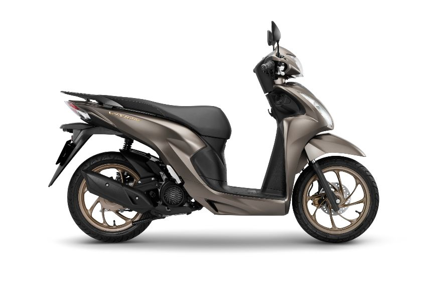

[🏠 Trang chủ](../../README.md) › [Vision](../../dong-xe/vision.md) › **BO1055**

# BO1055 · Vision 2026 xám YR381 bản đặc biệt

| | |
|---|---|
| **Mã bộ** | `BO1055` |
| **Tên bộ** | Bộ nhựa (Dàn áo) Vision 2026 xám YR381 bản đặc biệt |
| **Đời xe** | VISION ĐB 2026 YR381 |
| **Model** | NSC110T 2V,7V |
| **Dòng xe** | Vision |
| **Số chi tiết** | 28 |

## Chi tiết trong bộ

| STT | Mã chi tiết | Tên chi tiết | Dùng chung | Mã thay thế | Ghi chú |
|---:|---|---|:---:|---|---|
| 1 | [`53205K2CV90ZH`](../../tra-ma/5320.md#53205k2cv90zh) | NẮP TRƯỚC TAY LÁI \*YR381M\* |  | [`77200K2CV00ZD`](../../tra-ma/772.md#77200k2cv00zd) |  |
| 2 | [`53210K2CV90ZB`](../../tra-ma/5321.md#53210k2cv90zb) | BỘ NẮP SAU TAY LÁI \*NH1\* |  | [`81200K2CV00ZD`](../../tra-ma/812.md#81200k2cv00zd) |  |
| 3 | [`61100K2CV00ZR`](../../tra-ma/611.md#61100k2cv00zr) | CHẮN BÙN TRƯỚC \*YR381M\* |  | [`86831K2CV00ZA`](../../tra-ma/868.md#86831k2cv00za) |  |
| 4 | [`64301K2CV00ZP`](../../tra-ma/6430.md#64301k2cv00zp) | ỐP TRƯỚC BÊN PHẢI \*YR381M\* |  |  |  |
| 5 | [`64302K2CV00ZQ`](../../tra-ma/6430.md#64302k2cv00zq) | ỐP TRƯỚC \*YR381M\* |  |  |  |
| 6 | [`64305K2CW10ZB`](../../tra-ma/6430.md#64305k2cw10zb) | BỘ ỐP MẶT NẠ TRƯỚC \*NHB83M\* |  |  |  |
| 7 | [`64310K2CV00ZB`](../../tra-ma/6431.md#64310k2cv00zb) | SÀN ĐỂ CHÂN \*NH1\* |  |  |  |
| 8 | [`64401K2CV00ZP`](../../tra-ma/6440.md#64401k2cv00zp) | ỐP TRƯỚC BÊN TRÁI \*YR381M\* |  |  |  |
| 9 | [`64460K2CV00ZB`](../../tra-ma/6446.md#64460k2cv00zb) | NẮP ẮC QUY \*NH1\* |  |  |  |
| 10 | [`80110K2CV00ZA`](../../tra-ma/8011.md#80110k2cv00za) | CHẮN BÙN SAU \*NH1\* |  |  |  |
| 11 | [`80125K2CV00ZA`](../../tra-ma/8012.md#80125k2cv00za) | BỘ NẮP ĐÈN SOI BIỂN SỐ \*NH1\* |  |  |  |
| 12 | [`80151K2CV00ZB`](../../tra-ma/8015.md#80151k2cv00zb) | ỐP TRUNG TÂM \*NH1\* |  |  |  |
| 13 | [`81131K2CV90ZB`](../../tra-ma/8113.md#81131k2cv90zb) | ỐP TRONG PHÍA TRÊN \*NH1\* |  |  |  |
| 14 | [`81132GAH000ZW`](../../tra-ma/8113.md#81132gah000zw) | MÓC TREO HÀNG \*NH1\* |  |  |  |
| 15 | [`81133K2CV90ZB`](../../tra-ma/8113.md#81133k2cv90zb) | NẮP HỘP ĐỒ TRƯỚC \*NH1\* |  |  |  |
| 16 | [`81141K2CV00ZB`](../../tra-ma/8114.md#81141k2cv00zb) | ỐP TRÊN BÊN TRONG \*NH1\* |  |  |  |
| 17 | [`81145K2CV90ZB`](../../tra-ma/8114.md#81145k2cv90zb) | NẮP KHẨN CẤP \*NH1\* |  |  |  |
| 18 | [`83505K2CVK0ZB`](../../tra-ma/8350.md#83505k2cvk0zb) | BỘ ỐP SƯỜN PHẢI \*YR381M\* |  |  |  |
| 19 | [`83520K2CV00ZP`](../../tra-ma/8352.md#83520k2cv00zp) | ỐP SÀN PHẢI \*YR381M\* |  |  |  |
| 20 | [`83605K2CVK0ZB`](../../tra-ma/8360.md#83605k2cvk0zb) | BỘ ỐP SƯỜN TRÁI \*YR381M\* |  |  |  |
| 21 | [`83620K2CV00ZP`](../../tra-ma/8362.md#83620k2cv00zp) | ỐP SÀN BÊN TRÁI \*YR381M\* |  |  |  |
| 22 | [`83700K2CV00ZP`](../../tra-ma/837.md#83700k2cv00zp) | ỐP ĐUÔI SAU TRÊN \*YR381M\* |  |  |  |
| 23 | [`83751K2CV00ZA`](../../tra-ma/837.md#83751k2cv00za) | ỐP DƯỚI ĐUÔI SAU\*NH1\* |  |  |  |
| 24 | [`64308K2CV00`](../../tra-ma/6430.md#64308k2cv00) | ỐP TRƯỚC PHÍA DƯỚI |  |  |  |
| 25 | [`81137K2CV90`](../../tra-ma/8113.md#81137k2cv90) | NẮP ĐẬY BỘ SẠC USB |  |  |  |
| 26 | [`81136K2CV90`](../../tra-ma/8113.md#81136k2cv90) | HỘP CHỨA ĐỒ BÊN TRONG |  |  |  |
| 27 | [`50611K2CV00`](../../tra-ma/506.md#50611k2cv00) | ỐP NHỰA DƯỚI GẦM |  |  |  |
| 28 | [`80130K2CV00`](../../tra-ma/8013.md#80130k2cv00) | CHẮN BÙN SAU BÊN TRONG |  |  |  |

Cập nhật 11/11/2026
