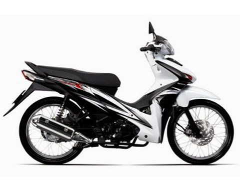

[🏠 Trang chủ](../../README.md) › [Wave RSX](../../dong-xe/wave-rsx.md) › **BO0048**

# BO0048 · Wave RSX 110 2010 trắng NHA96P

| | |
|---|---|
| **Mã bộ** | `BO0048` |
| **Tên bộ** | Bộ nhựa (Dàn áo) Wave RSX 110 2010 trắng NHA96P |
| **Đời xe** | K03 WAVE RSX 110 2010 màu trắng -A96P |
| **Model** | Y8 Y9 |
| **Dòng xe** | Wave RSX |
| **Số chi tiết** | 21 |

## Chi tiết trong bộ

| STT | Mã chi tiết | Tên chi tiết | Dùng chung | Mã thay thế | Ghi chú |
|---:|---|---|:---:|---|---|
| 1 | [`33708KWW600ZT`](../../tra-ma/337.md#33708kww600zt) | ốp đuôi sau \*NHA96P\* |  |  |  |
| 2 | [`53203KWWA00ZQ`](../../tra-ma/5320.md#53203kwwa00zq) | Nắp trên tay lái \*NHA69P\* |  |  |  |
| 3 | [`53205KWWV00ZF`](../../tra-ma/5320.md#53205kwwv00zf) | Nắp trước tay lái \*NHA96P\* |  |  |  |
| 4 | [`53206KWWV00ZE`](../../tra-ma/5320.md#53206kwwv00ze) | Nắp sau tay lái \*NHA96P\* |  |  |  |
| 5 | [`61100KWWA00YC`](../../tra-ma/611.md#61100kwwa00yc) | Chắn bùn A trước \*NHA96P\* |  |  |  |
| 6 | [`61200KWWA00`](../../tra-ma/612.md#61200kwwa00) | Chắn bùn B trước | ✔ |  |  |
| 7 | [`64100K03V70ZA`](../../tra-ma/641.md#64100k03v70za) | Bộ nắp trên ốp trước \*NHA96P\* |  |  |  |
| 8 | [`64200K03V70ZA`](../../tra-ma/642.md#64200k03v70za) | Bộ ốp trước \*NHA96P\* |  |  |  |
| 9 | [`64300K03V70ZA`](../../tra-ma/6430.md#64300k03v70za) | Bộ ốp ống yếm phải \*NHA96P\* |  |  |  |
| 10 | [`64305K03V70ZA`](../../tra-ma/6430.md#64305k03v70za) | Bộ ốp ống yếm trái \*NHA96P\* |  |  |  |
| 11 | [`64310KWW710ZG`](../../tra-ma/6431.md#64310kww710zg) | ốp ống yếm trước \*NHA96P\* |  |  |  |
| 12 | [`64320KWWA00`](../../tra-ma/6432.md#64320kwwa00) | ốp ống yếm sau | ✔ |  |  |
| 13 | [`64340KWWA00`](../../tra-ma/6434.md#64340kwwa00) | ốp trung tâm | ✔ |  |  |
| 14 | [`64350K03V70ZA`](../../tra-ma/6435.md#64350k03v70za) | Bộ ốp trung tâm phải \*NHA96P\* |  |  |  |
| 15 | [`64355K03V70ZA`](../../tra-ma/6435.md#64355k03v70za) | Bộ ốp trung tâm trái \*NHA96P\* |  |  |  |
| 16 | [`64480KWWA00`](../../tra-ma/6448.md#64480kwwa00) | ốp sườn sau phải | ✔ |  |  |
| 17 | [`64490KWWA00`](../../tra-ma/6449.md#64490kwwa00) | ốp sườn sau trái | ✔ |  |  |
| 18 | [`64600K03V70ZA`](../../tra-ma/6460.md#64600k03v70za) | Bộ ốp sườn phải \*NHA96P\* |  |  |  |
| 19 | [`64650K03V70ZA`](../../tra-ma/6465.md#64650k03v70za) | Bộ ốp sườn trái \*NHA96P\* |  |  |  |
| 20 | [`64520KWWV00ZG`](../../tra-ma/645.md#64520kwwv00zg) | Nắp dưới ốp trước \*R340C\* |  |  |  |
| 21 | [`80110KWWB80ZA`](../../tra-ma/8011.md#80110kwwb80za) | Bộ chắn bùn sau | ✔ |  |  |

Cập nhật 11/11/2026
