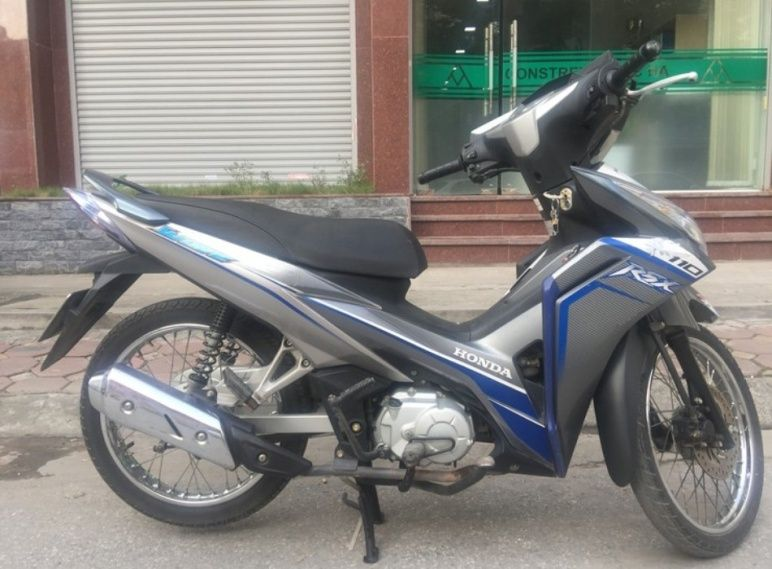

[🏠 Trang chủ](../../README.md) › [Wave RSX](../../dong-xe/wave-rsx.md) › **BO0049**

# BO0049 · Wave RSX110 2012 xám NHA62M K07

| | |
|---|---|
| **Mã bộ** | `BO0049` |
| **Tên bộ** | Bộ nhựa (Dàn áo) Wave RSX110 2012 xám NHA62M K07 |
| **Đời xe** | K07 WAVE RSX 110 2012 màu xám - A62 |
| **Model** | J1 J2 |
| **Dòng xe** | Wave RSX |
| **Số chi tiết** | 28 |

## Chi tiết trong bộ

| STT | Mã chi tiết | Tên chi tiết | Dùng chung | Mã thay thế | Ghi chú |
|---:|---|---|:---:|---|---|
| 1 | [`53203K07940ZE`](../../tra-ma/5320.md#53203k07940ze) | Nắp trên tay lái phải \*NH-A62M |  |  |  |
| 2 | [`53204K07940ZE`](../../tra-ma/5320.md#53204k07940ze) | Nắp trên tay lái trái \*NH-A62M |  |  |  |
| 3 | [`53205K07940`](../../tra-ma/5320.md#53205k07940) | Nắp tay lái trước | ✔ |  |  |
| 4 | [`53206K07940`](../../tra-ma/5320.md#53206k07940) | Nắp tay lái sau | ✔ |  |  |
| 5 | [`53207K07940`](../../tra-ma/5320.md#53207k07940) | MẶT NẠ ĐỒNG HỒ | ✔ |  |  |
| 6 | [`53209K07940ZA`](../../tra-ma/5320.md#53209k07940za) | Nắp ốp đồng hồ  \*NH-B24M\* | ✔ |  |  |
| 7 | [`61100K07900ZH`](../../tra-ma/611.md#61100k07900zh) | Chắn bùn A trước \*NH-A62M\* |  |  |  |
| 8 | [`61200KWW640ZB`](../../tra-ma/612.md#61200kww640zb) | Chắn bùn B trước \*NH1\* | ✔ |  |  |
| 9 | [`64200K07940ZB`](../../tra-ma/642.md#64200k07940zb) | Bộ ốp mặt nạ trước \*NHA62\* |  |  |  |
| 10 | [`64310K07940ZA`](../../tra-ma/6431.md#64310k07940za) | Ốp ống yếm chính \*NH-1\* | ✔ |  |  |
| 11 | [`64320K07900ZH`](../../tra-ma/6432.md#64320k07900zh) | ỐP ỐNG NỐI BẦU LỌC GIÓ \*NH-A62 |  |  |  |
| 12 | [`64350K07900ZB`](../../tra-ma/6435.md#64350k07900zb) | Ốp trong cánh yếm phải \*NH-1\* | ✔ |  |  |
| 13 | [`64360K07900ZB`](../../tra-ma/6436.md#64360k07900zb) | Ốp trong cánh yếm trái \*NH-1\* | ✔ |  |  |
| 14 | [`64370K07900ZB`](../../tra-ma/6437.md#64370k07900zb) | Ốp ống yếm phải \*NH-1\* | ✔ |  |  |
| 15 | [`64380K07900ZB`](../../tra-ma/6438.md#64380k07900zb) | Ốp ống yếm trái \*NH-1\* | ✔ |  |  |
| 16 | [`64440K07940ZA`](../../tra-ma/6444.md#64440k07940za) | Bộ ốp đuôi sau NHA62 | ✔ |  |  |
| 17 | [`64440K07940ZD`](../../tra-ma/6444.md#64440k07940zd) | Bộ ốp đuôi sau NHA69 |  |  |  |
| 18 | [`64460K07940ZH`](../../tra-ma/6446.md#64460k07940zh) | Bộ ốp ống yếm phải NHA62 |  |  |  |
| 19 | [`64465K07940ZH`](../../tra-ma/6446.md#64465k07940zh) | Bộ ốp ống yếm trái NHA62 |  |  |  |
| 20 | [`64470K07900ZE`](../../tra-ma/6447.md#64470k07900ze) | NẸP CẠNH BÊN PHẢI \*PB-387R\* |  |  |  |
| 21 | [`64475K07900ZE`](../../tra-ma/6447.md#64475k07900ze) | NẸP CẠNH BÊN TRÁI \*PB-387R\* |  |  |  |
| 22 | [`64490K07900`](../../tra-ma/6449.md#64490k07900) | Bộ nắp dưới đèn hậu | ✔ |  |  |
| 23 | [`64600K07940ZB`](../../tra-ma/6460.md#64600k07940zb) | Bộ ốp sườn phải \*NHA62\* |  |  |  |
| 24 | [`64650K07940ZB`](../../tra-ma/6465.md#64650k07940zb) | Bộ ốp sườn trái \*NHA62\* |  |  |  |
| 25 | [`64700K07940ZH`](../../tra-ma/647.md#64700k07940zh) | Bộ cánh yếm phải NHA62 |  |  |  |
| 26 | [`64750K07940ZH`](../../tra-ma/647.md#64750k07940zh) | Bộ cánh yếm trái NHA62 |  |  |  |
| 27 | [`80100K07940ZA`](../../tra-ma/8010.md#80100k07940za) | Chắn bùn sau \*NH-1\* | ✔ |  |  |
| 28 | [`80155K07900`](../../tra-ma/8015.md#80155k07900) | Nắp đèn soi biển số | ✔ |  |  |

Cập nhật 11/11/2026
