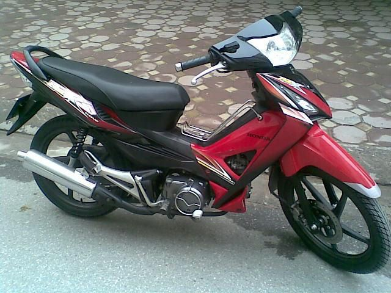

[🏠 Trang chủ](../../README.md) › [Wave RSX](../../dong-xe/wave-rsx.md) › **BO0167**

# BO0167 · Wave RSX 100 2008 Đỏ đen R315P

| | |
|---|---|
| **Mã bộ** | `BO0167` |
| **Tên bộ** | Bộ nhựa (Dàn áo) Wave RSX 100 2008 Đỏ đen R315P |
| **Đời xe** | Wave RSX 100 Năm 2008 màu Đỏ đen - 315 |
| **Model** | Y1 Y2 |
| **Dòng xe** | Wave RSX |
| **Số chi tiết** | 16 |

## Chi tiết trong bộ

| STT | Mã chi tiết | Tên chi tiết | Dùng chung | Mã thay thế | Ghi chú |
|---:|---|---|:---:|---|---|
| 1 | [`53205KVRV80ZA`](../../tra-ma/5320.md#53205kvrv80za) | Nắp trước tay lái \*NHA69P\* |  |  |  |
| 2 | [`53206KTL640`](../../tra-ma/5320.md#53206ktl640) | Nắp sau tay lái | ✔ |  |  |
| 3 | [`61100KVRV80ZD`](../../tra-ma/611.md#61100kvrv80zd) | Chắn bùn A trước \*R315P\* |  |  |  |
| 4 | [`61200KTL640`](../../tra-ma/612.md#61200ktl640) | Chắn bùn B trước | ✔ |  |  |
| 5 | [`64200KVRV60ZB`](../../tra-ma/642.md#64200kvrv60zb) | Bộ ốp yếm phải \*R315P\* |  |  |  |
| 6 | [`64250KVRV60ZB`](../../tra-ma/642.md#64250kvrv60zb) | Bộ ốp yếm trái \*R315P\* |  |  |  |
| 7 | [`64300KVRV60ZB`](../../tra-ma/6430.md#64300kvrv60zb) | Bộ mặt nạ trước \*R315P\* |  |  |  |
| 8 | [`64320KVRV80`](../../tra-ma/6432.md#64320kvrv80) | ốp ống yếm chính | ✔ |  |  |
| 9 | [`64350KVLT10`](../../tra-ma/6435.md#64350kvlt10) | Tấm ốp trung tâm phải | ✔ |  |  |
| 10 | [`64360KVLT10`](../../tra-ma/6436.md#64360kvlt10) | Tấm ốp trung tâm trái | ✔ |  |  |
| 11 | [`64600KVRV60ZB`](../../tra-ma/6460.md#64600kvrv60zb) | Bộ ốp sườn phải \*R315P\* |  |  |  |
| 12 | [`64650KVRV60ZB`](../../tra-ma/6465.md#64650kvrv60zb) | Bộ ốp sườn trái \*R315P\* |  |  |  |
| 13 | [`64700KVRV60ZB`](../../tra-ma/647.md#64700kvrv60zb) | Bộ cánh yếm phải \*R315P\* |  |  |  |
| 14 | [`64750KVRV60ZB`](../../tra-ma/647.md#64750kvrv60zb) | Bộ cánh yếm trái \*R315P\* |  |  |  |
| 15 | [`80100KVLT10`](../../tra-ma/8010.md#80100kvlt10) | Chắn bùn sau | ✔ | [`80110KVLT20ZA`](../../tra-ma/8011.md#80110kvlt20za) |  |
| 16 | [`83510KVRV80ZD`](../../tra-ma/8351.md#83510kvrv80zd) | ốp đuôi sau \*R315P\* |  |  |  |

Cập nhật 11/11/2026
