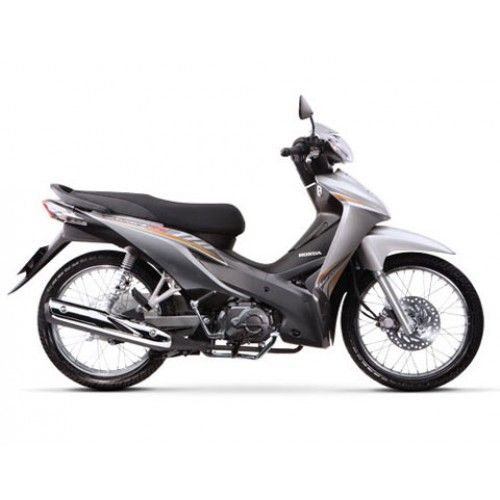

[🏠 Trang chủ](../../README.md) › [Wave](../../dong-xe/wave.md) › **BO0013**

# BO0013 · Wave 110S 2011 bạc 411

| | |
|---|---|
| **Mã bộ** | `BO0013` |
| **Tên bộ** | Bộ nhựa (Dàn áo) Wave 110S 2011 bạc 411 |
| **Đời xe** | WAVE 110S đời 2011 màu bạc 411 |
| **Model** | K7 K8 |
| **Dòng xe** | Wave |
| **Số chi tiết** | 21 |

## Chi tiết trong bộ

| STT | Mã chi tiết | Tên chi tiết | Dùng chung | Mã thay thế | Ghi chú |
|---:|---|---|:---:|---|---|
| 1 | [`33708KWW600ZH`](../../tra-ma/337.md#33708kww600zh) | ốp đuôi sau \*NH411M\* |  |  |  |
| 2 | [`53203KWWA00ZR`](../../tra-ma/5320.md#53203kwwa00zr) | Nắp trên tay lái \*NH411M\* |  |  |  |
| 3 | [`53205KWWB20`](../../tra-ma/5320.md#53205kwwb20) | Nắp trước tay lái | ✔ |  |  |
| 4 | [`53206KWWE00`](../../tra-ma/5320.md#53206kwwe00) | Nắp sau tay lái | ✔ |  |  |
| 5 | [`61100KWW640ZW`](../../tra-ma/611.md#61100kww640zw) | Chắn bùn A trước \*NH411\* |  | [`61100KWWA00ZQ`](../../tra-ma/611.md#61100kwwa00zq) |  |
| 6 | [`61200KWW640ZB`](../../tra-ma/612.md#61200kww640zb) | Chắn bùn B trước \*NH1\* | ✔ |  |  |
| 7 | [`64200KWWE20ZB`](../../tra-ma/642.md#64200kwwe20zb) | Bộ ốp trước \*NH411\* |  |  |  |
| 8 | [`64310KWW640`](../../tra-ma/6431.md#64310kww640) | ốp ống yếm trước | ✔ |  |  |
| 9 | [`64320KWWA80`](../../tra-ma/6432.md#64320kwwa80) | ốp ống yếm sau | ✔ |  |  |
| 10 | [`64325KWW640ZR`](../../tra-ma/6432.md#64325kww640zr) | ốp trung tâm phải \*NHA62M\* |  |  |  |
| 11 | [`64330KWW640ZS`](../../tra-ma/6433.md#64330kww640zs) | ốp trung tâm trái \*NHA62M\* |  |  |  |
| 12 | [`64340KWW640ZB`](../../tra-ma/6434.md#64340kww640zb) | ốp trung tâm \*NH1\* | ✔ |  |  |
| 13 | [`64400KWWA80ZH`](../../tra-ma/6440.md#64400kwwa80zh) | ốp ống yếm phải \*NHA62M\* |  |  |  |
| 14 | [`64450KWWA80ZH`](../../tra-ma/6445.md#64450kwwa80zh) | ốp ống yếm trái \*NHA62M\* |  |  |  |
| 15 | [`64470KWW640ZQ`](../../tra-ma/6447.md#64470kww640zq) | Cánh yếm dưới phải \*NHA62M\* |  |  |  |
| 16 | [`64475KWW640ZQ`](../../tra-ma/6447.md#64475kww640zq) | Cánh yếm dưới trái \*NHA62M\* |  |  |  |
| 17 | [`64480KWWA00`](../../tra-ma/6448.md#64480kwwa00) | ốp sườn sau phải | ✔ |  |  |
| 18 | [`64490KWWA00`](../../tra-ma/6449.md#64490kwwa00) | ốp sườn sau trái | ✔ |  |  |
| 19 | [`64600KWWE20ZB`](../../tra-ma/6460.md#64600kwwe20zb) | Bộ ốp sườn phải \*NH411\* |  |  |  |
| 20 | [`64650KWWE20ZB`](../../tra-ma/6465.md#64650kwwe20zb) | Bộ ốp sườn trái \*NH411\* |  |  |  |
| 21 | [`80100KWWA80ZA`](../../tra-ma/8010.md#80100kwwa80za) | Chắn bùn sau \*NH-1\* | ✔ |  |  |

Cập nhật 11/11/2026
