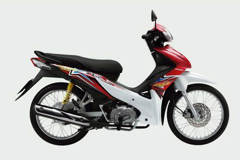

[🏠 Trang chủ](../../README.md) › [Wave](../../dong-xe/wave.md) › **BO0031**

# BO0031 · Wave 110 RS sao 2010 đỏ 263

| | |
|---|---|
| **Mã bộ** | `BO0031` |
| **Tên bộ** | Bộ nhựa (Dàn áo) Wave 110 RS sao 2010 đỏ 263 |
| **Đời xe** | KWWG WAVE 110RS tem sao đời 2010 màu đỏ 263 |
| **Model** | E5 E6 |
| **Dòng xe** | Wave |
| **Số chi tiết** | 20 |

## Chi tiết trong bộ

| STT | Mã chi tiết | Tên chi tiết | Dùng chung | Mã thay thế | Ghi chú |
|---:|---|---|:---:|---|---|
| 1 | [`33708KWW600YE`](../../tra-ma/337.md#33708kww600ye) | ốp đuôi sau \*R263\* |  |  |  |
| 2 | [`53203KWWA00YL`](../../tra-ma/5320.md#53203kwwa00yl) | Nắp trên tay lái \*R263\* |  |  |  |
| 3 | [`53205KWWB20`](../../tra-ma/5320.md#53205kwwb20) | Nắp trước tay lái | ✔ |  |  |
| 4 | [`53206KWWB20`](../../tra-ma/5320.md#53206kwwb20) | Nắp sau tay lái | ✔ | [`53206KWWE00`](../../tra-ma/5320.md#53206kwwe00) |  |
| 5 | [`61100KWWA00YK`](../../tra-ma/611.md#61100kwwa00yk) | Chắn bùn A trước \*NH193P\* |  | [`61100KWW640YN`](../../tra-ma/611.md#61100kww640yn) |  |
| 6 | [`61200KWWA00`](../../tra-ma/612.md#61200kwwa00) | Chắn bùn B trước | ✔ |  |  |
| 7 | [`64200KWWC60ZD`](../../tra-ma/642.md#64200kwwc60zd) | Bộ ốp trước \*R263\* |  |  |  |
| 8 | [`64310KWW600`](../../tra-ma/6431.md#64310kww600) | ốp ống yếm trước | ✔ |  |  |
| 9 | [`64320KWWA00`](../../tra-ma/6432.md#64320kwwa00) | ốp ống yếm sau | ✔ |  |  |
| 10 | [`64340KWWA00`](../../tra-ma/6434.md#64340kwwa00) | ốp trung tâm | ✔ |  |  |
| 11 | [`64350KWWC60ZD`](../../tra-ma/6435.md#64350kwwc60zd) | Bộ ốp trung tâm phải \*R263\* |  |  |  |
| 12 | [`64355KWWC60ZD`](../../tra-ma/6435.md#64355kwwc60zd) | Bộ ốp trung tâm trái \*R263\* |  |  |  |
| 13 | [`64400KWWA00ZW`](../../tra-ma/6440.md#64400kwwa00zw) | ốp ống yếm phải \*NH193P\* |  |  |  |
| 14 | [`64450KWWA00ZW`](../../tra-ma/6445.md#64450kwwa00zw) | ốp ống yếm trái \*NH193P\* |  |  |  |
| 15 | [`64480KWWA00`](../../tra-ma/6448.md#64480kwwa00) | ốp sườn sau phải | ✔ |  |  |
| 16 | [`64490KWWA00`](../../tra-ma/6449.md#64490kwwa00) | ốp sườn sau trái | ✔ |  |  |
| 17 | [`64560KWWA00`](../../tra-ma/645.md#64560kwwa00) | Thông gió ốp sườn phải | ✔ |  |  |
| 18 | [`64600KWWC60ZD`](../../tra-ma/6460.md#64600kwwc60zd) | Bộ ốp sườn phải \*R263\* |  |  |  |
| 19 | [`64650KWWC60ZD`](../../tra-ma/6465.md#64650kwwc60zd) | Bộ ốp sườn trái \*R263\* |  |  |  |
| 20 | [`80110KWWB80ZA`](../../tra-ma/8011.md#80110kwwb80za) | Bộ chắn bùn sau | ✔ |  |  |

Cập nhật 11/11/2026
