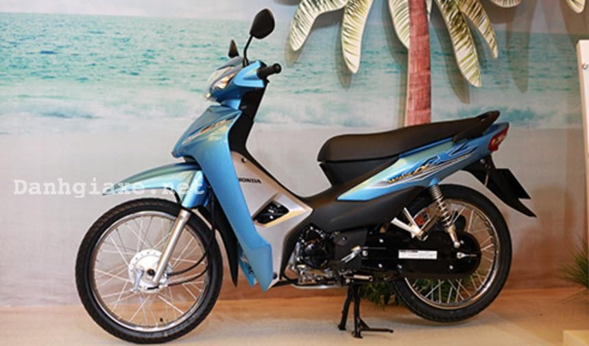

[🏠 Trang chủ](../../README.md) › [Wave](../../dong-xe/wave.md) › **BO0119**

# BO0119 · Wave α 110 2018 K89 Xanh B203

| | |
|---|---|
| **Mã bộ** | `BO0119` |
| **Tên bộ** | Bộ nhựa (Dàn áo) Wave α 110 2018 K89 Xanh B203 |
| **Đời xe** | WAVE Alpha 110 năm 2018 Màu Xanh B-203 |
| **Model** | T12 |
| **Dòng xe** | Wave |
| **Số chi tiết** | 16 |

## Chi tiết trong bộ

| STT | Mã chi tiết | Tên chi tiết | Dùng chung | Mã thay thế | Ghi chú |
|---:|---|---|:---:|---|---|
| 1 | [`53205K89V00ZE`](../../tra-ma/5320.md#53205k89v00ze) | Ốp tay lái trước \*B203M\* | ✔ |  |  |
| 2 | [`53206K89V00ZA`](../../tra-ma/5320.md#53206k89v00za) | Nắp sau tay lái \*NH1\* | ✔ |  |  |
| 3 | [`61100KWW640YB`](../../tra-ma/611.md#61100kww640yb) | Chắn bùn A trước \*B203\* |  |  |  |
| 4 | [`61200KWW640ZB`](../../tra-ma/612.md#61200kww640zb) | Chắn bùn B trước \*NH1\* | ✔ |  |  |
| 5 | [`64200K89V00ZA`](../../tra-ma/642.md#64200k89v00za) | Bộ ốp yếm phải \*NH411M\* |  |  |  |
| 6 | [`64250K89V00ZA`](../../tra-ma/642.md#64250k89v00za) | Bộ ốp yếm trái \*NH411M\* | ✔ |  |  |
| 7 | [`64300K89V00ZB`](../../tra-ma/6430.md#64300k89v00zb) | Bộ mặt nạ trước \*B203\* | ✔ | [`64300K89V30ZC`](../../tra-ma/6430.md#64300k89v30zc) |  |
| 8 | [`64320K89V00ZA`](../../tra-ma/6432.md#64320k89v00za) | Ốp ống yếm chính \*NH1\* | ✔ |  |  |
| 9 | [`64325K89V00ZA`](../../tra-ma/6432.md#64325k89v00za) | Ốp nhựa trung tâm phải \*NH1\* |  |  |  |
| 10 | [`64330K89V00ZA`](../../tra-ma/6433.md#64330k89v00za) | Ốp nhựa trung tâm trái \*NH1\* | ✔ |  |  |
| 11 | [`64430K89V00ZE`](../../tra-ma/6443.md#64430k89v00ze) | Cánh yếm phải \*B203M\* | ✔ |  |  |
| 12 | [`64600K89V20ZB`](../../tra-ma/6460.md#64600k89v20zb) | Bộ ốp sườn phải \*B203M\* | ✔ |  |  |
| 13 | [`64650K89V20ZB`](../../tra-ma/6465.md#64650k89v20zb) | Bộ ốp sườn trái \*B203M\* |  |  |  |
| 14 | [`64770K89V20ZB`](../../tra-ma/647.md#64770k89v20zb) | Cánh yếm trái \*B203M\* |  |  |  |
| 15 | [`80110K89V00ZA`](../../tra-ma/8011.md#80110k89v00za) | Chắn bùn sau \*TYPE1\* |  |  |  |
| 16 | [`83510K89V00ZE`](../../tra-ma/8351.md#83510k89v00ze) | Ốp đuôi sau \*B203M\* |  |  |  |

Cập nhật 11/11/2026
