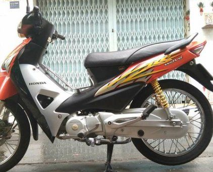

[🏠 Trang chủ](../../README.md) › [Wave](../../dong-xe/wave.md) › **BO0151**

# BO0151 · Wave RS 100 2005 Vàng đen\*YR272M\*

| | |
|---|---|
| **Mã bộ** | `BO0151` |
| **Tên bộ** | Bộ nhựa (Dàn áo) Wave RS 100 2005 Vàng đen\*YR272M\* |
| **Đời xe** | Wave RS 100 Năm 2005 màu Vàng đen - 272 |
| **Model** | S |
| **Dòng xe** | Wave |
| **Số chi tiết** | 16 |

## Chi tiết trong bộ

| STT | Mã chi tiết | Tên chi tiết | Dùng chung | Mã thay thế | Ghi chú |
|---:|---|---|:---:|---|---|
| 1 | [`33710KTL641`](../../tra-ma/337.md#33710ktl641) | Bộ chóa đèn & chắn bùn sau | ✔ |  |  |
| 2 | [`53205KTL640ZD`](../../tra-ma/5320.md#53205ktl640zd) | Nắp trước tay lái \*YR272M\* |  |  |  |
| 3 | [`53206KTL640`](../../tra-ma/5320.md#53206ktl640) | Nắp sau tay lái | ✔ |  |  |
| 4 | [`61100KTL640ZD`](../../tra-ma/611.md#61100ktl640zd) | Chắn bùn A trước \*YR272M\* |  |  |  |
| 5 | [`61200KTL640`](../../tra-ma/612.md#61200ktl640) | Chắn bùn B trước | ✔ |  |  |
| 6 | [`64200KWYA00ZA`](../../tra-ma/642.md#64200kwya00za) | Bộ ốp yếm phải \*NH411M\* | ✔ |  |  |
| 7 | [`64250KWYA00ZA`](../../tra-ma/642.md#64250kwya00za) | Bộ ốp yếm trái \*NH411M\* | ✔ |  |  |
| 8 | [`64300KTL640ZD`](../../tra-ma/6430.md#64300ktl640zd) | Bộ mặt nạ trước \*YR272M\* |  |  |  |
| 9 | [`64320KTL640`](../../tra-ma/6432.md#64320ktl640) | ốp ống yếm chính | ✔ |  |  |
| 10 | [`64350KTL740`](../../tra-ma/6435.md#64350ktl740) | Tấm ốp trung tâm phải | ✔ | [`64340KTL640`](../../tra-ma/6434.md#64340ktl640) |  |
| 11 | [`64360KTL740`](../../tra-ma/6436.md#64360ktl740) | Tấm ốp trung tâm trái | ✔ | [`64345KTL640`](../../tra-ma/6434.md#64345ktl640) |  |
| 12 | [`64600KTL640ZA`](../../tra-ma/6460.md#64600ktl640za) | Bộ ốp sườn phải \*YR272M\* |  |  |  |
| 13 | [`64650KTL640ZA`](../../tra-ma/6465.md#64650ktl640za) | Bộ ốp sườn trái \*YR272M\* |  |  |  |
| 14 | [`64750KTL640ZA`](../../tra-ma/647.md#64750ktl640za) | Bộ cánh yếm phải \*YR272M\* |  |  |  |
| 15 | [`64770KTL640ZA`](../../tra-ma/647.md#64770ktl640za) | Bộ cánh yếm trái \*YR272M\* |  |  |  |
| 16 | [`83510KTL640ZD`](../../tra-ma/8351.md#83510ktl640zd) | ốp đuôi sau \*YR272M\* |  |  |  |

Cập nhật 11/11/2026
