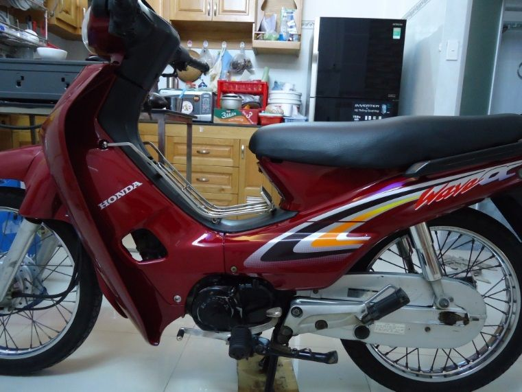

[🏠 Trang chủ](../../README.md) › [Wave](../../dong-xe/wave.md) › **BO0172**

# BO0172 · Wave α 100 Cũ 2002 Đỏ Sẫm R203 máy đen

| | |
|---|---|
| **Mã bộ** | `BO0172` |
| **Tên bộ** | Bộ nhựa (Dàn áo) Wave α 100 Cũ 2002 Đỏ Sẫm R203 máy đen |
| **Đời xe** | WAVE α Cũ năm 2002 Màu Bạc Đỏ Sẫm R-203 |
| **Model** | I |
| **Dòng xe** | Wave |
| **Số chi tiết** | 16 |

## Chi tiết trong bộ

| STT | Mã chi tiết | Tên chi tiết | Dùng chung | Mã thay thế | Ghi chú |
|---:|---|---|:---:|---|---|
| 1 | [`53205KFLD21ZF`](../../tra-ma/5320.md#53205kfld21zf) | Nắp trước tay lái \*R203M\* |  |  |  |
| 2 | [`53206KFL851ZB`](../../tra-ma/5320.md#53206kfl851zb) | Nắp sau tay lái \*NH1\* | ✔ |  |  |
| 3 | [`61100KFL850ZM`](../../tra-ma/611.md#61100kfl850zm) | Chắn bùn trước \*R203M\* |  |  |  |
| 4 | [`61200KEV900ZM`](../../tra-ma/612.md#61200kev900zm) | ốp giảm xóc trước phải \*R203M\* |  |  |  |
| 5 | [`61400KEV900ZM`](../../tra-ma/614.md#61400kev900zm) | ốp giảm xóc trước trái \*R203M\* |  |  |  |
| 6 | [`64200KRS900ZD`](../../tra-ma/642.md#64200krs900zd) | Bộ ốp yếm phải \*R203M\* đỏ |  | [`64400KEV900ZM`](../../tra-ma/6440.md#64400kev900zm) |  |
| 7 | [`64250KRS900ZD`](../../tra-ma/642.md#64250krs900zd) | Bộ ốp yếm trái \*R203M\* |  | [`64450KEV900ZK`](../../tra-ma/6445.md#64450kev900zk) |  |
| 8 | [`64300KRS900ZD`](../../tra-ma/6430.md#64300krs900zd) | Bộ mặt nạ trước \*R203M\* |  | [`64500KFLD20ZH`](../../tra-ma/645.md#64500kfld20zh) |  |
| 9 | [`64320KEV900ZB`](../../tra-ma/6432.md#64320kev900zb) | ốp ống yếm chính \*NH1\* | ✔ |  |  |
| 10 | [`64430KEV900ZQ`](../../tra-ma/6443.md#64430kev900zq) | Cánh yếm phải \*R203M\* |  |  |  |
| 11 | [`64440KEV900ZQ`](../../tra-ma/6444.md#64440kev900zq) | Cánh yếm trái \*R203M\* |  |  |  |
| 12 | [`64600KRS900ZF`](../../tra-ma/6460.md#64600krs900zf) | Bộ ốp sườn phải \*R203M\* |  | [`64370KEV750ZU`](../../tra-ma/6437.md#64370kev750zu) |  |
| 13 | [`64650KRS900ZF`](../../tra-ma/6465.md#64650krs900zf) | Bộ ốp sườn trái \*R203M\* |  | [`64380KEV750ZU`](../../tra-ma/6438.md#64380kev750zu) |  |
| 14 | [`80100KEV900`](../../tra-ma/8010.md#80100kev900) | Chắn bùn sau | ✔ |  |  |
| 15 | [`83400KRS900ZF`](../../tra-ma/834.md#83400krs900zf) | Bộ cốp phải \*R203M\* |  | [`83500KEV900ZM`](../../tra-ma/8350.md#83500kev900zm) |  |
| 16 | [`83600KRS900ZD`](../../tra-ma/8360.md#83600krs900zd) | Bộ ốp đuôi sau \*R203M\* |  | [`83510KEV900ZM`](../../tra-ma/8351.md#83510kev900zm) |  |

Cập nhật 11/11/2026
