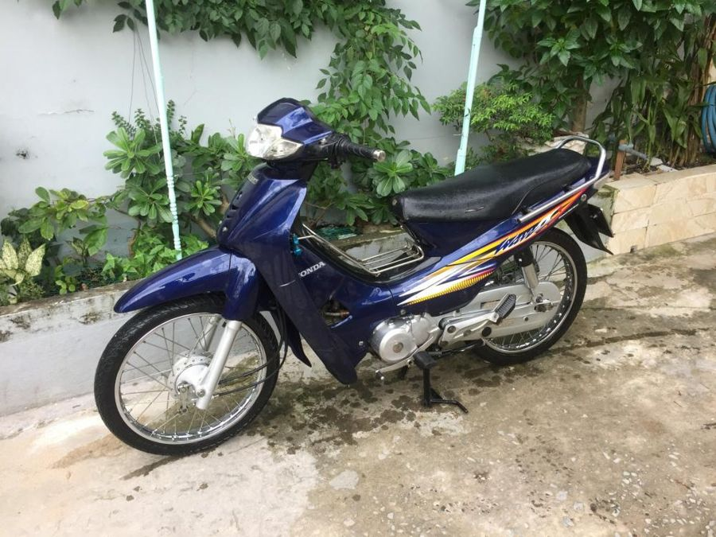

[🏠 Trang chủ](../../README.md) › [Wave](../../dong-xe/wave.md) › **BO0181**

# BO0181 · Wave α 100 Cũ + 2004 Xanh đậm RB171

| | |
|---|---|
| **Mã bộ** | `BO0181` |
| **Tên bộ** | Bộ nhựa (Dàn áo) Wave α 100 Cũ + 2004 Xanh đậm RB171 |
| **Đời xe** | WAVE α + Cũ năm 2004 Màu Xanh đậm RB-171M-U |
| **Model** | M |
| **Dòng xe** | Wave |
| **Số chi tiết** | 16 |

## Chi tiết trong bộ

| STT | Mã chi tiết | Tên chi tiết | Dùng chung | Mã thay thế | Ghi chú |
|---:|---|---|:---:|---|---|
| 1 | [`53205KFLD21ZK`](../../tra-ma/5320.md#53205kfld21zk) | Nắp trước tay lái \*PB171MU\* |  |  |  |
| 2 | [`53206KFL851ZB`](../../tra-ma/5320.md#53206kfl851zb) | Nắp sau tay lái \*NH1\* | ✔ |  |  |
| 3 | [`61100KFL850ZR`](../../tra-ma/611.md#61100kfl850zr) | Chắn bùn trước \*PB171MU\* |  |  |  |
| 4 | [`61200KEV900ZY`](../../tra-ma/612.md#61200kev900zy) | ốp giảm xóc trước phải \*PB171M |  |  |  |
| 5 | [`61400KEV900ZY`](../../tra-ma/614.md#61400kev900zy) | ốp giảm xóc trước trái \*PB171M |  |  |  |
| 6 | [`64200KRSV50ZB`](../../tra-ma/642.md#64200krsv50zb) | Bộ ốp yếm phải \*PB171MU\* |  | [`64400KEV900ZS`](../../tra-ma/6440.md#64400kev900zs) |  |
| 7 | [`64250KRSV50ZB`](../../tra-ma/642.md#64250krsv50zb) | Bộ ốp yếm trái \*PB171MU\* |  | [`64250KRS860ZH`](../../tra-ma/642.md#64250krs860zh) [`64450KEV900ZQ`](../../tra-ma/6445.md#64450kev900zq) |  |
| 8 | [`64300KRS900ZK`](../../tra-ma/6430.md#64300krs900zk) | Bộ mặt nạ trước \*PB171MU\* |  | [`64500KFLD20ZM`](../../tra-ma/645.md#64500kfld20zm) |  |
| 9 | [`64320KEV900ZB`](../../tra-ma/6432.md#64320kev900zb) | ốp ống yếm chính \*NH1\* | ✔ |  |  |
| 10 | [`64430KEV900ZX`](../../tra-ma/6443.md#64430kev900zx) | Cánh yếm phải \*PB171MU\* |  |  |  |
| 11 | [`64440KEV900ZX`](../../tra-ma/6444.md#64440kev900zx) | Cánh yếm trái \*PB171MU\* |  |  |  |
| 12 | [`64600KRSV50ZB`](../../tra-ma/6460.md#64600krsv50zb) | Bộ ốp sườn phải \*PB171MU\* |  | [`64370KEV750ZY`](../../tra-ma/6437.md#64370kev750zy) |  |
| 13 | [`64650KRSV50ZB`](../../tra-ma/6465.md#64650krsv50zb) | Bộ ốp sườn trái \*PB171MU\* |  | [`64380KEV750ZY`](../../tra-ma/6438.md#64380kev750zy) |  |
| 14 | [`80100KEV900`](../../tra-ma/8010.md#80100kev900) | Chắn bùn sau | ✔ |  |  |
| 15 | [`83400KRSV50ZB`](../../tra-ma/834.md#83400krsv50zb) | Bộ cốp phải \*PB171MU\* |  | [`83500KEV900YH`](../../tra-ma/8350.md#83500kev900yh) |  |
| 16 | [`83600KRSV50ZB`](../../tra-ma/8360.md#83600krsv50zb) | Bộ ốp đuôi sau \*PB171MU\* |  | [`83510KEV900YH`](../../tra-ma/8351.md#83510kev900yh) |  |

Cập nhật 11/11/2026
