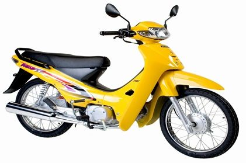

[🏠 Trang chủ](../../README.md) › [Wave](../../dong-xe/wave.md) › **BO0184**

# BO0184 · Wave α 100 Cũ 2004 Vàng Y106

| | |
|---|---|
| **Mã bộ** | `BO0184` |
| **Tên bộ** | Bộ nhựa (Dàn áo) Wave α 100 Cũ 2004 Vàng Y106 |
| **Đời xe** | WAVE α  Cũ năm 2004 Màu Vàng Y-106 |
| **Model** | O |
| **Dòng xe** | Wave |
| **Số chi tiết** | 16 |

## Chi tiết trong bộ

| STT | Mã chi tiết | Tên chi tiết | Dùng chung | Mã thay thế | Ghi chú |
|---:|---|---|:---:|---|---|
| 1 | [`53205KFLD21ZQ`](../../tra-ma/5320.md#53205kfld21zq) | Nắp trước tay lái \*Y106\* |  |  |  |
| 2 | [`53206KFL851ZB`](../../tra-ma/5320.md#53206kfl851zb) | Nắp sau tay lái \*NH1\* | ✔ |  |  |
| 3 | [`61100KFL850ZX`](../../tra-ma/611.md#61100kfl850zx) | Chắn bùn trước \*Y106\* |  |  |  |
| 4 | [`61200KEV900YE`](../../tra-ma/612.md#61200kev900ye) | ốp giảm xóc trước phải \*Y106\* |  |  |  |
| 5 | [`61400KEV900YF`](../../tra-ma/614.md#61400kev900yf) | ốp giảm xóc trước trái \*Y106\* |  |  |  |
| 6 | [`64200KTL790ZB`](../../tra-ma/642.md#64200ktl790zb) | Bộ ốp yếm phải \*Y106\* |  | [`64400KEV900ZY`](../../tra-ma/6440.md#64400kev900zy) |  |
| 7 | [`64250KTL790ZB`](../../tra-ma/642.md#64250ktl790zb) | Bộ ốp yếm trái \*Y106\* |  | [`64450KEV900ZW`](../../tra-ma/6445.md#64450kev900zw) |  |
| 8 | [`64300KRS900ZN`](../../tra-ma/6430.md#64300krs900zn) | Bộ mặt nạ trước \*Y106\* |  | [`64500KFLD20ZR`](../../tra-ma/645.md#64500kfld20zr) |  |
| 9 | [`64320KEV900ZB`](../../tra-ma/6432.md#64320kev900zb) | ốp ống yếm chính \*NH1\* | ✔ |  |  |
| 10 | [`64430KEV900YE`](../../tra-ma/6443.md#64430kev900ye) | Cánh yếm phải \*Y106\* |  |  |  |
| 11 | [`64440KEV900YE`](../../tra-ma/6444.md#64440kev900ye) | Cánh yếm trái \*Y106\* |  |  |  |
| 12 | [`64600KTL790ZB`](../../tra-ma/6460.md#64600ktl790zb) | Bộ ốp sườn phải \*Y106\* |  | [`64370KTL790ZB`](../../tra-ma/6437.md#64370ktl790zb) |  |
| 13 | [`64650KTL790ZB`](../../tra-ma/6465.md#64650ktl790zb) | Bộ ốp sườn trái \*Y106\* |  | [`64380KTL790ZB`](../../tra-ma/6438.md#64380ktl790zb) |  |
| 14 | [`80100KEV900`](../../tra-ma/8010.md#80100kev900) | Chắn bùn sau | ✔ |  |  |
| 15 | [`83400KTL790ZB`](../../tra-ma/834.md#83400ktl790zb) | Bộ cốp phải \*Y106\* |  | [`83500KEV900ZT`](../../tra-ma/8350.md#83500kev900zt) |  |
| 16 | [`83600KTL790ZB`](../../tra-ma/8360.md#83600ktl790zb) | Bộ ốp đuôi sau \*Y106\* |  | [`83510KEV900ZT`](../../tra-ma/8351.md#83510kev900zt) |  |

Cập nhật 11/11/2026
