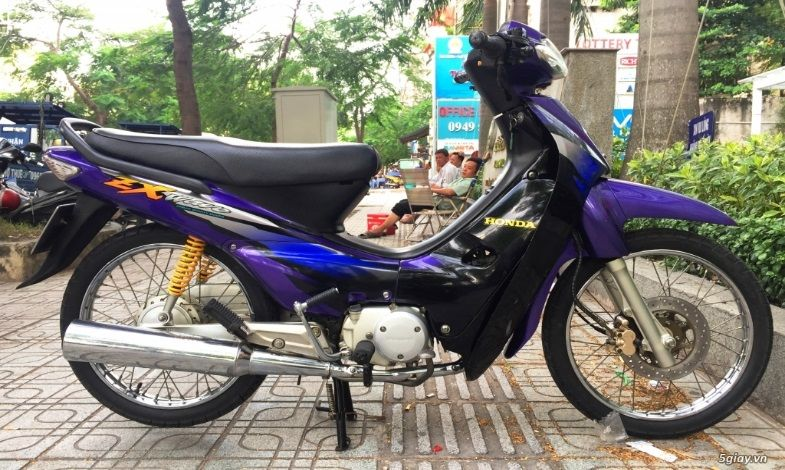

[🏠 Trang chủ](../../README.md) › [Wave](../../dong-xe/wave.md) › **BO0187**

# BO0187 · Wave ZX 2004 Tím đen RP138M

| | |
|---|---|
| **Mã bộ** | `BO0187` |
| **Tên bộ** | Bộ nhựa (Dàn áo) Wave ZX 2004 Tím đen RP138M |
| **Đời xe** | WAVE ZX năm 2004 Màu Tím đen RP138M |
| **Model** | Q |
| **Dòng xe** | Wave |
| **Số chi tiết** | 16 |

## Chi tiết trong bộ

| STT | Mã chi tiết | Tên chi tiết | Dùng chung | Mã thay thế | Ghi chú |
|---:|---|---|:---:|---|---|
| 1 | [`53205KFLD31ZW`](../../tra-ma/5320.md#53205kfld31zw) | Nắp trước tay lái \*RP138M\* |  |  |  |
| 2 | [`53206KFL851ZB`](../../tra-ma/5320.md#53206kfl851zb) | Nắp sau tay lái \*NH1\* | ✔ |  |  |
| 3 | [`61100KFL850YG`](../../tra-ma/611.md#61100kfl850yg) | Chắn bùn trước \*RP138M\* |  |  |  |
| 4 | [`61200KFL860YA`](../../tra-ma/612.md#61200kfl860ya) | ốp giảm xóc trước phải \*RP138M |  |  |  |
| 5 | [`61400KEV900YP`](../../tra-ma/614.md#61400kev900yp) | ốp giảm xóc trước trái \*RP138M |  |  |  |
| 6 | [`64200KTL780ZC`](../../tra-ma/642.md#64200ktl780zc) | Bộ ốp yếm phải RP138P |  |  |  |
| 7 | [`64250KTL780ZC`](../../tra-ma/642.md#64250ktl780zc) | Bộ ốp yếm trái RP138P |  |  |  |
| 8 | [`64300KRS900ZR`](../../tra-ma/6430.md#64300krs900zr) | Bộ mặt nạ trước \*RP138M\* |  |  |  |
| 9 | [`64320KEV900ZB`](../../tra-ma/6432.md#64320kev900zb) | ốp ống yếm chính \*NH1\* | ✔ |  |  |
| 10 | [`64600KTL780ZC`](../../tra-ma/6460.md#64600ktl780zc) | Bộ ốp sườn phải \*RP138M\* |  |  |  |
| 11 | [`64650KTL780ZC`](../../tra-ma/6465.md#64650ktl780zc) | Bộ ốp sườn trái \*RP138M\* |  |  |  |
| 12 | [`64750KTL780ZC`](../../tra-ma/647.md#64750ktl780zc) | Bộ cánh yếm PHAI RP138P |  |  |  |
| 13 | [`64770KTL780ZC`](../../tra-ma/647.md#64770ktl780zc) | Bộ cánh yếm trái \*RP138M\* |  |  |  |
| 14 | [`80100KEV900`](../../tra-ma/8010.md#80100kev900) | Chắn bùn sau | ✔ |  |  |
| 15 | [`83400KTL780ZC`](../../tra-ma/834.md#83400ktl780zc) | Bộ cốp phải \*RP138M\* |  |  |  |
| 16 | [`83600KTL780ZC`](../../tra-ma/8360.md#83600ktl780zc) | Bộ ốp đuôi sau \*RP138M\* |  |  |  |

Cập nhật 11/11/2026
