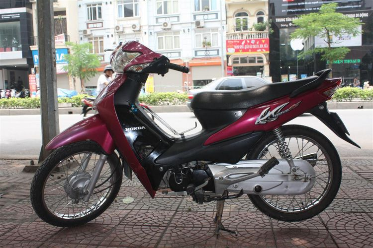

[🏠 Trang chủ](../../README.md) › [Wave](../../dong-xe/wave.md) › **BO0192**

# BO0192 · Wave Cá 2006 Màu Tím RP-173M

| | |
|---|---|
| **Mã bộ** | `BO0192` |
| **Tên bộ** | Bộ nhựa (Dàn áo) Wave Cá 2006 Màu Tím RP-173M |
| **Đời xe** | WAVE Cá năm 2006 Màu Tím RP-173M |
| **Model** | W3 |
| **Dòng xe** | Wave |
| **Số chi tiết** | 16 |

## Chi tiết trong bộ

| STT | Mã chi tiết | Tên chi tiết | Dùng chung | Mã thay thế | Ghi chú |
|---:|---|---|:---:|---|---|
| 1 | [`33710KTL641`](../../tra-ma/337.md#33710ktl641) | Bộ chóa đèn & chắn bùn sau | ✔ |  |  |
| 2 | [`53205KTL680ZH`](../../tra-ma/5320.md#53205ktl680zh) | Nắp trước tay lái \*RP173M\* |  | [`53205KTLV00ZH`](../../tra-ma/5320.md#53205ktlv00zh) |  |
| 3 | [`53206KTL640`](../../tra-ma/5320.md#53206ktl640) | Nắp sau tay lái | ✔ |  |  |
| 4 | [`61100KTL640ZB`](../../tra-ma/611.md#61100ktl640zb) | Chắn bùn A trước \*RP173M\* |  |  |  |
| 5 | [`61200KTL640`](../../tra-ma/612.md#61200ktl640) | Chắn bùn B trước | ✔ |  |  |
| 6 | [`64200KTL680ZA`](../../tra-ma/642.md#64200ktl680za) | Bộ ốp yếm phải \*NH1\* | ✔ |  |  |
| 7 | [`64250KTL680ZA`](../../tra-ma/642.md#64250ktl680za) | Bộ ốp yếm trái \*NH1\* | ✔ |  |  |
| 8 | [`64300KVR910ZG`](../../tra-ma/6430.md#64300kvr910zg) | Bộ mặt nạ trước \*RP173M\* |  | [`64300KTL640ZB`](../../tra-ma/6430.md#64300ktl640zb) |  |
| 9 | [`64320KTL680`](../../tra-ma/6432.md#64320ktl680) | ốp ống yếm chính | ✔ |  |  |
| 10 | [`64350KTL740`](../../tra-ma/6435.md#64350ktl740) | Tấm ốp trung tâm phải | ✔ | [`64340KTL640`](../../tra-ma/6434.md#64340ktl640) |  |
| 11 | [`64360KTL740`](../../tra-ma/6436.md#64360ktl740) | Tấm ốp trung tâm trái | ✔ | [`64345KTL640`](../../tra-ma/6434.md#64345ktl640) |  |
| 12 | [`64430KTL640ZJ`](../../tra-ma/6443.md#64430ktl640zj) | Cánh yếm phải \*RP173M\* |  |  |  |
| 13 | [`64600KVR910ZG`](../../tra-ma/6460.md#64600kvr910zg) | Bộ ốp sườn phải \*RP173M\* |  |  |  |
| 14 | [`64650KVR910ZG`](../../tra-ma/6465.md#64650kvr910zg) | Bộ ốp sườn trái \*RP173M\* |  |  |  |
| 15 | [`64770KVR910ZG`](../../tra-ma/647.md#64770kvr910zg) | Bộ cánh yếm trái \*RP173M\* |  |  |  |
| 16 | [`83510KTL640ZB`](../../tra-ma/8351.md#83510ktl640zb) | ốp đuôi sau \*RP173M\* |  |  |  |

Cập nhật 11/11/2026
