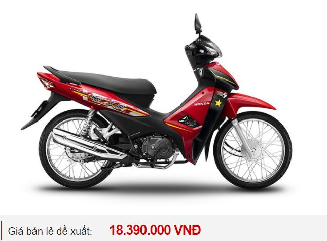

[🏠 Trang chủ](../../README.md) › [Wave](../../dong-xe/wave.md) › **BO0757**

# BO0757 · Wave α 110 2021 K89 phiên bản giới hạn ( Tem ngôi sao vàng, R263R - Màu Đỏ)

| | |
|---|---|
| **Mã bộ** | `BO0757` |
| **Tên bộ** | Bộ nhựa (Dàn áo) Wave α 110 2021 K89 phiên bản giới hạn ( Tem ngôi sao vàng, R263R - Màu Đỏ) |
| **Đời xe** | Wave Alpha phiên bản giới hạn 2021 ( Tem ngôi sao vàng, R263R - Màu Đỏ) - K89H |
| **Dòng xe** | Wave |
| **Số chi tiết** | 16 |

## Chi tiết trong bộ

| STT | Mã chi tiết | Tên chi tiết | Dùng chung | Mã thay thế | Ghi chú |
|---:|---|---|:---:|---|---|
| 1 | [`64300K89V60ZA`](../../tra-ma/6430.md#64300k89v60za) |  |  |  |  |
| 2 | [`64650K89V60ZA`](../../tra-ma/6465.md#64650k89v60za) |  |  |  |  |
| 3 | [`64250K89V60ZA`](../../tra-ma/642.md#64250k89v60za) |  |  |  |  |
| 4 | [`64600K89V60ZA`](../../tra-ma/6460.md#64600k89v60za) |  |  |  |  |
| 5 | [`64200K89V60ZA`](../../tra-ma/642.md#64200k89v60za) |  |  |  |  |
| 6 | [`53205K89V00ZC`](../../tra-ma/5320.md#53205k89v00zc) |  |  |  |  |
| 7 | [`64330K89V00ZA`](../../tra-ma/6433.md#64330k89v00za) |  |  |  |  |
| 8 | [`64320K89V00ZA`](../../tra-ma/6432.md#64320k89v00za) |  |  |  |  |
| 9 | [`64325K89V00ZA`](../../tra-ma/6432.md#64325k89v00za) |  |  |  |  |
| 10 | [`53206K89H00ZA`](../../tra-ma/5320.md#53206k89h00za) |  |  |  |  |
| 11 | [`83510K89V00ZA`](../../tra-ma/8351.md#83510k89v00za) |  |  |  |  |
| 12 | [`61100KWW640ZU`](../../tra-ma/611.md#61100kww640zu) |  |  |  |  |
| 13 | [`61200KWW640ZB`](../../tra-ma/612.md#61200kww640zb) |  |  |  |  |
| 14 | [`80110K89V00ZA`](../../tra-ma/8011.md#80110k89v00za) |  |  |  |  |
| 15 | [`64770K89V60ZA`](../../tra-ma/647.md#64770k89v60za) |  |  |  |  |
| 16 | [`64760K89V60ZA`](../../tra-ma/647.md#64760k89v60za) |  |  |  |  |

Cập nhật 11/11/2026
