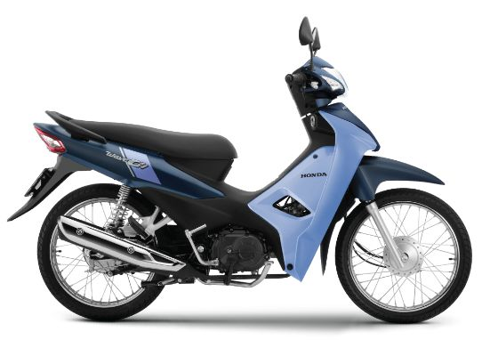

[🏠 Trang chủ](../../README.md) › [Wave](../../dong-xe/wave.md) › **BO0949**

# BO0949 · Wave α 110 2025, phiên bản cổ điển, màu Xanh PB434

| | |
|---|---|
| **Mã bộ** | `BO0949` |
| **Tên bộ** | Bộ nhựa (Dàn áo) Wave α 110 2025, phiên bản cổ điển, màu Xanh PB434 |
| **Đời xe** | Wave Alpha 110cc năm 2025 - Phiên bản cổ điển - Màu Xanh - PB434 |
| **Dòng xe** | Wave |
| **Số chi tiết** | 15 |

## Chi tiết trong bộ

| STT | Mã chi tiết | Tên chi tiết | Dùng chung | Mã thay thế | Ghi chú |
|---:|---|---|:---:|---|---|
| 1 | [`64300K89VD0ZB`](../../tra-ma/6430.md#64300k89vd0zb) | Bộ ốp mặt nạ trước \*PB434M\* |  |  |  |
| 2 | [`64650K89VD0ZB`](../../tra-ma/6465.md#64650k89vd0zb) | Bộ ốp sườn trái \*PB434M\* |  |  |  |
| 3 | [`64250K89VD0ZB`](../../tra-ma/642.md#64250k89vd0zb) | Bộ ốp ống yếm trái \*PB408P\* |  |  |  |
| 4 | [`64600K89VD0ZB`](../../tra-ma/6460.md#64600k89vd0zb) | Bộ ốp sườn phải \*PB434M\* |  |  |  |
| 5 | [`64200K89VD0ZB`](../../tra-ma/642.md#64200k89vd0zb) | Bộ ốp ống yếm phải \*PB408P\* |  |  |  |
| 6 | [`53205K89V00ZY`](../../tra-ma/5320.md#53205k89v00zy) | Ốp tay lái trước \*PB434M\* |  |  |  |
| 7 | [`64330K89V00ZA`](../../tra-ma/6433.md#64330k89v00za) | Ốp nhựa trung tâm trái \*NH1\* |  |  |  |
| 8 | [`64320K89V00ZA`](../../tra-ma/6432.md#64320k89v00za) | Ốp ống yếm chính \*NH1\* |  |  |  |
| 9 | [`64325K89V00ZA`](../../tra-ma/6432.md#64325k89v00za) | Ốp nhựa trung tâm phải \*NH1\* |  |  |  |
| 10 | [`53206K89H00ZA`](../../tra-ma/5320.md#53206k89h00za) | Nắp sau tay lái \*NH1\* |  |  |  |
| 11 | [`61100KWW640B6`](../../tra-ma/611.md#61100kww640b6) | Chắn bùn A trước \*PB434M\* |  |  |  |
| 12 | [`61200KWW640ZB`](../../tra-ma/612.md#61200kww640zb) | Chắn bùn B trước \*NH1\* |  |  |  |
| 13 | [`80110K89V00ZA`](../../tra-ma/8011.md#80110k89v00za) | Chắn bùn sau \*NH1\* |  |  |  |
| 14 | [`64770K89VD0ZB`](../../tra-ma/647.md#64770k89vd0zb) | Bộ cánh yếm trái \*PB408P\* |  |  |  |
| 15 | [`64430K89V00ZY`](../../tra-ma/6443.md#64430k89v00zy) | Cánh yếm phải \*PB408P\* |  |  |  |

Cập nhật 11/11/2026
