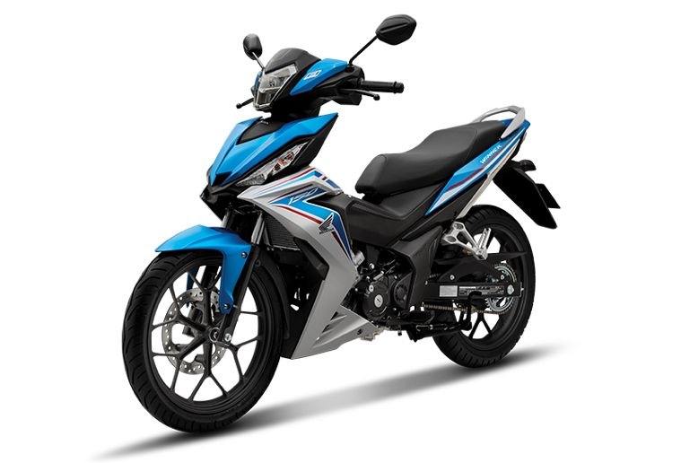

[🏠 Trang chủ](../../README.md) › [Winner](../../dong-xe/winner.md) › **BO0102**

# BO0102 · Winner 2017 K56 V1 Xanh B189C

| | |
|---|---|
| **Mã bộ** | `BO0102` |
| **Tên bộ** | Bộ nhựa (Dàn áo) Winner 2017 K56 V1 Xanh B189C |
| **Đời xe** | Winner năm 2017 Màu Xanh B189C |
| **Model** | Wl2 |
| **Dòng xe** | Winner |
| **Số chi tiết** | 26 |

## Chi tiết trong bộ

| STT | Mã chi tiết | Tên chi tiết | Dùng chung | Mã thay thế | Ghi chú |
|---:|---|---|:---:|---|---|
| 1 | [`50606K56N10`](../../tra-ma/506.md#50606k56n10) | Tấm bảo vệ giá để chân phải |  |  |  |
| 2 | [`40510K56N10`](../../tra-ma/405.md#40510k56n10) | Nắp hộp xích Winner 2016, |  |  |  |
| 3 | [`50607K56N10`](../../tra-ma/506.md#50607k56n10) | Nắp hộp bình ắc quy |  |  |  |
| 4 | [`50706K56N10`](../../tra-ma/507.md#50706k56n10) | Tấm bảo vệ giá để chân trái |  |  |  |
| 5 | [`53205K56V00`](../../tra-ma/5320.md#53205k56v00) | Nắp trước tay lái |  |  |  |
| 6 | [`53207K56V00ZG`](../../tra-ma/5320.md#53207k56v00zg) | Nắp trên tay lái phải \*B189\* |  |  |  |
| 7 | [`53215K56V00ZG`](../../tra-ma/5321.md#53215k56v00zg) | Nắp trên tay lái trái \*B189\* |  |  |  |
| 8 | [`53216K56V00ZB`](../../tra-ma/5321.md#53216k56v00zb) | Bộ ốp tay lái \*NH1\* |  |  |  |
| 9 | [`61100K56V00ZH`](../../tra-ma/611.md#61100k56v00zh) | Chắn bùn trước \*B189C\* |  |  |  |
| 10 | [`61200K56N10`](../../tra-ma/612.md#61200k56n10) | Chắn bùn B trước |  |  |  |
| 11 | [`64300K56V00ZB`](../../tra-ma/6430.md#64300k56v00zb) | Bộ mặt nạ trước \*TYPE1\* |  |  |  |
| 12 | [`64301K56V00ZG`](../../tra-ma/6430.md#64301k56v00zg) | Ốp nhựa trước \*B189\* |  |  |  |
| 13 | [`64320K56V00ZA`](../../tra-ma/6432.md#64320k56v00za) | Ốp ống yếm chính \*NH1\* |  |  |  |
| 14 | [`64325K56N10`](../../tra-ma/6432.md#64325k56n10) | Bộ ốp yếm sau |  |  |  |
| 15 | [`64400K56V30ZG`](../../tra-ma/6440.md#64400k56v30zg) | Bộ ốp sườn phải \*TYPE1\* |  |  |  |
| 16 | [`64450K56V30ZG`](../../tra-ma/6445.md#64450k56v30zg) | Bộ ốp sườn trái \*TYPE1\* |  |  |  |
| 17 | [`64510K56N10`](../../tra-ma/645.md#64510k56n10) | Bộ ốp yếm phải |  |  |  |
| 18 | [`64520K56N10`](../../tra-ma/645.md#64520k56n10) | Bộ ốp yếm trái |  |  |  |
| 19 | [`64600K56V30ZC`](../../tra-ma/6460.md#64600k56v30zc) | Bộ ốp yếm sau phải \*B189C\* |  |  |  |
| 20 | [`64630K56N10`](../../tra-ma/6463.md#64630k56n10) | Ốp yếm dưới |  |  |  |
| 21 | [`64650K56V30ZC`](../../tra-ma/6465.md#64650k56v30zc) | Bộ ốp yếm sau trái \*B189C\* |  |  |  |
| 22 | [`80100K56N10`](../../tra-ma/8010.md#80100k56n10) | Chắn bùn sau trên |  |  |  |
| 23 | [`80110K56V00`](../../tra-ma/8011.md#80110k56v00) | Chắn bùn sau dưới |  |  |  |
| 24 | [`80150K56V00`](../../tra-ma/8015.md#80150k56v00) | Chắn bùn B sau |  |  |  |
| 25 | [`83500K56V30ZC`](../../tra-ma/8350.md#83500k56v30zc) | Bộ ốp đuôi sau \*B189C\* |  | [`83500K56V00ZE`](../../tra-ma/8350.md#83500k56v00ze) |  |
| 26 | [`83520K56N10`](../../tra-ma/8352.md#83520k56n10) | Nắp đèn hậu |  |  |  |

Cập nhật 11/11/2026
