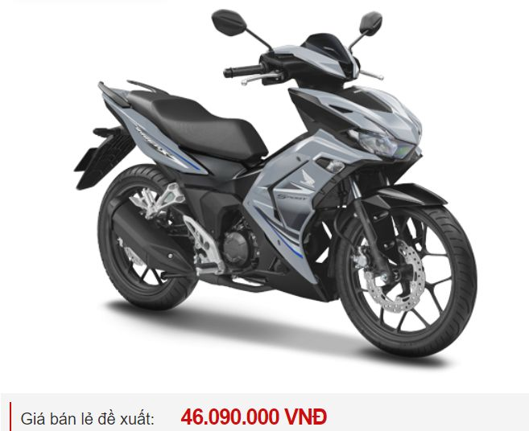

[🏠 Trang chủ](../../README.md) › [Winner](../../dong-xe/winner.md) › **BO0786**

# BO0786 · WinnerX 2022 V3 màu Bạc \*NHB56M\* bản tiêu chuẩn, phanh thường

| | |
|---|---|
| **Mã bộ** | `BO0786` |
| **Tên bộ** | Bộ nhựa (Dàn áo) WinnerX 2022 V3 màu Bạc \*NHB56M\* bản tiêu chuẩn, phanh thường |
| **Đời xe** | Winner 2022 - Phiên bản Tiêu Chuẩn - Màu Bạc - NHB56M (Phanh Thường) |
| **Model** | 150FN |
| **Dòng xe** | Winner |
| **Số chi tiết** | 34 |

## Chi tiết trong bộ

| STT | Mã chi tiết | Tên chi tiết | Dùng chung | Mã thay thế | Ghi chú |
|---:|---|---|:---:|---|---|
| 1 | [`53270K2PV60ZC`](../../tra-ma/5327.md#53270k2pv60zc) | Ốp trên tay lái \*NHB56M\* |  |  |  |
| 2 | [`64650K2PV60ZA`](../../tra-ma/6465.md#64650k2pv60za) | Bộ ốp trước trái \*NHB56\* |  |  |  |
| 3 | [`64600K2PV60ZA`](../../tra-ma/6460.md#64600k2pv60za) | Bộ ốp trước phải \*NHB56\* |  |  |  |
| 4 | [`64471K2PV60ZD`](../../tra-ma/6447.md#64471k2pv60zd) | Ốp trung tâm \*NHB56\* |  |  |  |
| 5 | [`64300K2PV60ZA`](../../tra-ma/6430.md#64300k2pv60za) | Bộ mặt nạ trước \*NH1\* | ✔ |  |  |
| 6 | [`64450K2PV60ZA`](../../tra-ma/6445.md#64450k2pv60za) | Bộ ốp sườn sau trái \*NHB56\* |  |  |  |
| 7 | [`64400K2PV60ZA`](../../tra-ma/6440.md#64400k2pv60za) | Bộ ốp sườn sau phải \*NHB56\* |  |  |  |
| 8 | [`53205K2PM00ZA`](../../tra-ma/5320.md#53205k2pm00za) | Nắp trước tay lái \*NH1\* | ✔ |  |  |
| 9 | [`64301K2PV60ZC`](../../tra-ma/6430.md#64301k2pv60zc) | Ốp trước \*NHB56\* |  |  |  |
| 10 | [`64360K2PV60ZC`](../../tra-ma/6436.md#64360k2pv60zc) | Ốp trước trái \*NH1\* |  |  |  |
| 11 | [`64670K2PV60ZB`](../../tra-ma/6467.md#64670k2pv60zb) | Ốp dưới trái \*NH1\* |  |  |  |
| 12 | [`64328K2PV60ZB`](../../tra-ma/6432.md#64328k2pv60zb) | Bộ ốp ống yếm sau trái \*NH1\* |  |  |  |
| 13 | [`64350K2PV60ZC`](../../tra-ma/6435.md#64350k2pv60zc) | Ốp trước phải \*NH1\* |  |  |  |
| 14 | [`64660K2PV60ZB`](../../tra-ma/6466.md#64660k2pv60zb) | Ốp dưới phải \*NH1\* |  |  |  |
| 15 | [`64327K2PV60ZB`](../../tra-ma/6432.md#64327k2pv60zb) | Bộ ốp ống yếm sau phải \*NH1\* |  |  |  |
| 16 | [`61100K56V50ZP`](../../tra-ma/611.md#61100k56v50zp) | Chắn bùn trước \*R389\* |  |  |  |
| 17 | [`53206K2PV60`](../../tra-ma/5320.md#53206k2pv60) | Nắp sau tay lái \*NH1\* | ✔ |  |  |
| 18 | [`53209K56V50`](../../tra-ma/5320.md#53209k56v50) | Giã giữ đồng hồ tốc độ | ✔ |  |  |
| 19 | [`53306K2PM00`](../../tra-ma/533.md#53306k2pm00) | Tấm chắn đồng hồ tốc độ trước | ✔ |  |  |
| 20 | [`61200K56V50`](../../tra-ma/612.md#61200k56v50) | Chắn bùn B trước | ✔ |  |  |
| 21 | [`50607K2PV60`](../../tra-ma/506.md#50607k2pv60) | Nắp hộp bình ắc quy | ✔ |  |  |
| 22 | [`50707K2PV60`](../../tra-ma/507.md#50707k2pv60) | Bảo vệ để chân trái | ✔ |  |  |
| 23 | [`64430K2PV60`](../../tra-ma/6443.md#64430k2pv60) | Ốp trong thân bên phải | ✔ |  |  |
| 24 | [`64440K2PV60`](../../tra-ma/6444.md#64440k2pv60) | Ốp trong thân bên trái | ✔ |  |  |
| 25 | [`64510K2PV60`](../../tra-ma/645.md#64510k2pv60) | Ốp trong phải | ✔ |  |  |
| 26 | [`64520K2PV60`](../../tra-ma/645.md#64520k2pv60) | Ốp trong trái | ✔ |  |  |
| 27 | [`64611K2PV60`](../../tra-ma/6461.md#64611k2pv60) | Ốp B bên phải | ✔ |  |  |
| 28 | [`64615K2PV60`](../../tra-ma/6461.md#64615k2pv60) | Nắp bình chứa nước làm mát | ✔ |  |  |
| 29 | [`64621K2PV60`](../../tra-ma/6462.md#64621k2pv60) | Ốp B bên trái | ✔ |  |  |
| 30 | [`64630K2PV60`](../../tra-ma/6463.md#64630k2pv60) | Ốp yếm dưới | ✔ |  |  |
| 31 | [`80100K56V50`](../../tra-ma/8010.md#80100k56v50) | Chắn bùn sau trên | ✔ |  |  |
| 32 | [`80110K56V00`](../../tra-ma/8011.md#80110k56v00) | Chắn bùn sau dưới | ✔ |  |  |
| 33 | [`80150K2PV60`](../../tra-ma/8015.md#80150k2pv60) | Chắn bùn B sau | ✔ |  |  |
| 34 | [`64320K2PV60`](../../tra-ma/6432.md#64320k2pv60) | Ốp ống yếm chính | ✔ |  |  |

## Mã thiếu bổ sung

_Không tính sẵn trong bộ, thêm khi khách cần._

| Mã | Tên |
|---|---|
| [`51400K2PV61`](../../tra-ma/514.md#51400k2pv61) |  |
| [`51500K2PV61`](../../tra-ma/515.md#51500k2pv61) |  |
| [`45250KWWB12`](../../tra-ma/452.md#45250kwwb12) |  |

Cập nhật 11/11/2026
