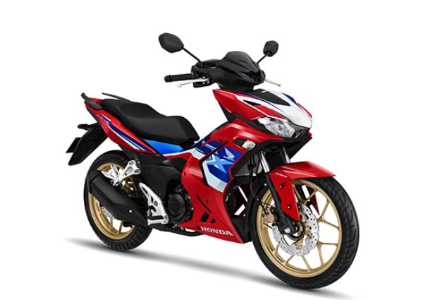

[🏠 Trang chủ](../../README.md) › [Winner](../../dong-xe/winner.md) › **BO0831**

# BO0831 · WinnerX 2023 V3 màu Đỏ Đen Trắng \*R389\*, bản thể thao

| | |
|---|---|
| **Mã bộ** | `BO0831` |
| **Tên bộ** | Bộ nhựa (Dàn áo) WinnerX 2023 V3 màu Đỏ Đen Trắng \*R389\*, bản thể thao |
| **Đời xe** | Winner 2023 - Phiên bản Thể Thao - Màu Đỏ Đen Trắng- R389 |
| **Dòng xe** | Winner |
| **Số chi tiết** | 34 |

## Chi tiết trong bộ

| STT | Mã chi tiết | Tên chi tiết | Dùng chung | Mã thay thế | Ghi chú |
|---:|---|---|:---:|---|---|
| 1 | [`53270K2PV60ZH`](../../tra-ma/5327.md#53270k2pv60zh) | Ốp trên tay lái \*NH1\* |  |  |  |
| 2 | [`64471K2PV60ZG`](../../tra-ma/6447.md#64471k2pv60zg) | Bộ ốp sườn trung tâm \*R389\* |  |  |  |
| 3 | [`64300K2PV60ZA`](../../tra-ma/6430.md#64300k2pv60za) | Bộ mặt nạ trước \*NH1\* |  |  |  |
| 4 | [`64310K2PVD0ZA`](../../tra-ma/6431.md#64310k2pvd0za) | Bộ ốp trước \*NH193\* |  |  |  |
| 5 | [`64675K2PV80ZA`](../../tra-ma/6467.md#64675k2pv80za) | Bộ ốp dưới trái \*R389\* |  |  |  |
| 6 | [`64450K2PVD0ZA`](../../tra-ma/6445.md#64450k2pvd0za) | Bộ ốp sườn sau trái \*R389\* |  |  |  |
| 7 | [`64326K2PVD0ZA`](../../tra-ma/6432.md#64326k2pvd0za) | Ốp ống yếm trái sau \*NH1\* |  |  |  |
| 8 | [`64650K2PVD0ZA`](../../tra-ma/6465.md#64650k2pvd0za) | Bộ ốp trước trái \*R389\* |  |  |  |
| 9 | [`64665K2PV80ZA`](../../tra-ma/6466.md#64665k2pv80za) | Bộ ốp dưới phải \*R389\* |  |  |  |
| 10 | [`64400K2PVD0ZA`](../../tra-ma/6440.md#64400k2pvd0za) | Bộ ốp sườn sau phải \*R389\* |  |  |  |
| 11 | [`64325K2PVD0ZA`](../../tra-ma/6432.md#64325k2pvd0za) | Ốp ống yếm phải sau \*NH1\* |  |  |  |
| 12 | [`64600K2PVD0ZA`](../../tra-ma/6460.md#64600k2pvd0za) | Bộ ốp trước phải \*R389\* |  |  |  |
| 13 | [`53205K2PM00ZA`](../../tra-ma/5320.md#53205k2pm00za) | Nắp trước tay lái \*NH1\* |  |  |  |
| 14 | [`64360K2PV60ZB`](../../tra-ma/6436.md#64360k2pv60zb) | Ốp trước trái \*R389\* |  |  |  |
| 15 | [`64350K2PV60ZB`](../../tra-ma/6435.md#64350k2pv60zb) | Ốp trước phải \*R389\* |  |  |  |
| 16 | [`61000K2PV70ZD`](../../tra-ma/610.md#61000k2pv70zd) | Bộ chặn bùn trước \*R389\* |  |  |  |
| 17 | [`53206K2PV60`](../../tra-ma/5320.md#53206k2pv60) | Nắp sau tay lái \*NH1\* |  |  |  |
| 18 | [`53209K56V50`](../../tra-ma/5320.md#53209k56v50) | Giã giữ đồng hồ tốc độ |  |  |  |
| 19 | [`53306K2PM00`](../../tra-ma/533.md#53306k2pm00) | Tấm chắn đồng hồ tốc độ trước |  |  |  |
| 20 | [`61200K56V50`](../../tra-ma/612.md#61200k56v50) | Chắn bùn B trước |  |  |  |
| 21 | [`50607K2PV60`](../../tra-ma/506.md#50607k2pv60) | Nắp hộp bình ắc quy |  |  |  |
| 22 | [`50707K2PV60`](../../tra-ma/507.md#50707k2pv60) | Bảo vệ để chân trái |  |  |  |
| 23 | [`64430K2PV60`](../../tra-ma/6443.md#64430k2pv60) | Ốp trong thân bên phải |  |  |  |
| 24 | [`64440K2PV60`](../../tra-ma/6444.md#64440k2pv60) | Ốp trong thân bên trái |  |  |  |
| 25 | [`64510K2PV60`](../../tra-ma/645.md#64510k2pv60) | Ốp trong phải |  |  |  |
| 26 | [`64520K2PV60`](../../tra-ma/645.md#64520k2pv60) | Ốp trong trái |  |  |  |
| 27 | [`64611K2PV60`](../../tra-ma/6461.md#64611k2pv60) | Ốp B bên phải |  |  |  |
| 28 | [`64615K2PV60`](../../tra-ma/6461.md#64615k2pv60) | Nắp bình chứa nước làm mát |  |  |  |
| 29 | [`64621K2PV60`](../../tra-ma/6462.md#64621k2pv60) | Ốp B bên trái |  |  |  |
| 30 | [`64630K2PV60`](../../tra-ma/6463.md#64630k2pv60) | Ốp yếm dưới |  |  |  |
| 31 | [`80100K56V50`](../../tra-ma/8010.md#80100k56v50) | Chắn bùn sau trên |  |  |  |
| 32 | [`80110K56V00`](../../tra-ma/8011.md#80110k56v00) | Chắn bùn sau dưới |  |  |  |
| 33 | [`80150K2PV60`](../../tra-ma/8015.md#80150k2pv60) | Chắn bùn B sau |  |  |  |
| 34 | [`64320K2PV70`](../../tra-ma/6432.md#64320k2pv70) | Ốp ống yếm chính |  |  |  |

Cập nhật 11/11/2026
