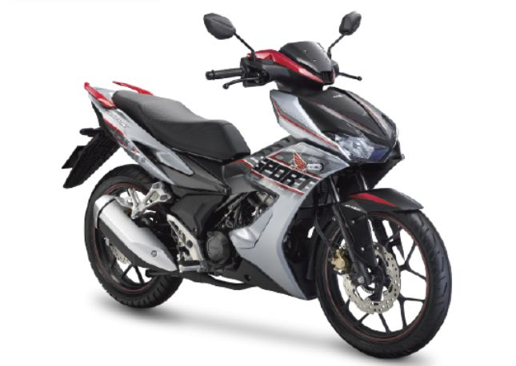

[🏠 Trang chủ](../../README.md) › [Winner](../../dong-xe/winner.md) › **BO0855**

# BO0855 · WinnerX 2020 V2 Màu Bạc Đen Đỏ (SPORT) - Phiên bản thể thao - Phanh ABS

| | |
|---|---|
| **Mã bộ** | `BO0855` |
| **Tên bộ** | Bộ nhựa (Dàn áo) WinnerX 2020 V2 Màu Bạc Đen Đỏ (SPORT) - Phiên bản thể thao - Phanh ABS |
| **Đời xe** | Winner X 150 năm 2020 Bạc Đen Đỏ - Phiên bản Thể Thao (Phanh ABS) |
| **Model** | Wl5 |
| **Dòng xe** | Winner |
| **Số chi tiết** | 39 |

## Chi tiết trong bộ

| STT | Mã chi tiết | Tên chi tiết | Dùng chung | Mã thay thế | Ghi chú |
|---:|---|---|:---:|---|---|
| 1 | [`86640K2PV00ZA`](../../tra-ma/866.md#86640k2pv00za) | Biểu tượng chữ WINNER X \*NHB56M\* |  |  |  |
| 1 | [`50606K56V50ZC`](../../tra-ma/506.md#50606k56v50zc) | Tấm bảo vệ phải \*NHA76M\* |  |  |  |
| 2 | [`50706K56V50ZC`](../../tra-ma/507.md#50706k56v50zc) | Tấm bảo vệ giá để chân trái \*NHA76M\* |  |  |  |
| 3 | [`53206K56V50ZA`](../../tra-ma/5320.md#53206k56v50za) | Nắp sau tay lái \*NH1\* |  |  |  |
| 4 | [`53207K56V50ZA`](../../tra-ma/5320.md#53207k56v50za) | Nắp trên tay lái \*NHB25B\* \*NHB25H\* |  |  |  |
| 5 | [`61000K2PV00ZA`](../../tra-ma/610.md#61000k2pv00za) | Bộ chắn bùn trước \*NHA76M\* |  |  |  |
| 6 | [`64310K2PV00ZA`](../../tra-ma/6431.md#64310k2pv00za) | Bộ tấm ốp bảo vệ yếm \*NHA76M\* |  |  |  |
| 7 | [`64300K56V50ZA`](../../tra-ma/6430.md#64300k56v50za) | Ốp trên mặt nạ xe \*NHB25H\* |  |  |  |
| 8 | [`64320K56V50ZA`](../../tra-ma/6432.md#64320k56v50za) | Ốp ống yếm chính  \*NH1\* |  |  |  |
| 9 | [`64325K2PV00ZA`](../../tra-ma/6432.md#64325k2pv00za) | ốp trung tâm phải \*NHA76M\* |  |  |  |
| 10 | [`64326K2PV00ZA`](../../tra-ma/6432.md#64326k2pv00za) | Ốp trung tâm trái \*NHA76M\* |  |  |  |
| 11 | [`64355K2PV00ZA`](../../tra-ma/6435.md#64355k2pv00za) | Bộ ốp trung tâm phải \*NHA56M\* |  |  |  |
| 12 | [`64365K2PV00ZA`](../../tra-ma/6436.md#64365k2pv00za) | Bộ ốp trung tâm trái \*NHA56M\* |  |  |  |
| 13 | [`64400K2PV00ZA`](../../tra-ma/6440.md#64400k2pv00za) | Bộ ốp sườn sau phải \*NHB56M\* |  |  |  |
| 14 | [`64430K56V50ZA`](../../tra-ma/6443.md#64430k56v50za) | Ốp trong thân bên phải \*NH1\* |  |  |  |
| 15 | [`64440K56V50ZA`](../../tra-ma/6444.md#64440k56v50za) | Ốp trong thân bên trái \*NH1\* |  |  |  |
| 16 | [`64450K2PV00ZA`](../../tra-ma/6445.md#64450k2pv00za) | Bộ ốp sườn sau trái \*NHB56M\* |  |  |  |
| 17 | [`64471K2PV00ZA`](../../tra-ma/6447.md#64471k2pv00za) | Bộ ốp sườn trung tâm \*NHB56M\* |  |  |  |
| 18 | [`64600K2PV00ZA`](../../tra-ma/6460.md#64600k2pv00za) | Bộ ốp trước phải \*NHB56M\* |  |  |  |
| 19 | [`64650K2PV00ZA`](../../tra-ma/6465.md#64650k2pv00za) | Bộ ốp sườn trái \*NHB56M\* |  |  |  |
| 20 | [`50707K56V50`](../../tra-ma/507.md#50707k56v50) | Bảo vệ để chân trái |  |  |  |
| 21 | [`53205K56V50`](../../tra-ma/5320.md#53205k56v50) | Nắp trước tay lái |  |  |  |
| 22 | [`53306K56V50`](../../tra-ma/533.md#53306k56v50) | Nắp sau tay lái trên |  |  |  |
| 23 | [`61200K56V50`](../../tra-ma/612.md#61200k56v50) | Chắn bùn B trước |  |  |  |
| 24 | [`64510K56V50`](../../tra-ma/645.md#64510k56v50) | Bộ ốp yếm phải |  |  |  |
| 25 | [`64520K56V50`](../../tra-ma/645.md#64520k56v50) | Bộ ốp yếm trái |  |  |  |
| 26 | [`64625K56V50`](../../tra-ma/6462.md#64625k56v50) | Ốp sườn trái B |  |  |  |
| 27 | [`64630K56V50`](../../tra-ma/6463.md#64630k56v50) | Ốp yếm dưới |  |  |  |
| 28 | [`64660K56V50`](../../tra-ma/6466.md#64660k56v50) | Ốp yếm dưới phải |  |  |  |
| 29 | [`64670K56V50`](../../tra-ma/6467.md#64670k56v50) | Ốp yếm dưới trái |  |  |  |
| 30 | [`80100K56V50`](../../tra-ma/8010.md#80100k56v50) | Chắn bùn sau trên |  |  |  |
| 31 | [`80110K56V00`](../../tra-ma/8011.md#80110k56v00) | Chắn bùn sau dưới |  |  |  |
| 32 | [`50197K56V50`](../../tra-ma/501.md#50197k56v50) |  |  |  |  |
| 33 | [`50607K56V50`](../../tra-ma/506.md#50607k56v50) |  |  |  |  |
| 34 | [`53209K56V50`](../../tra-ma/5320.md#53209k56v50) |  |  |  |  |
| 35 | [`64615K56V50`](../../tra-ma/6461.md#64615k56v50) |  |  |  |  |
| 36 | [`83520K56V50`](../../tra-ma/8352.md#83520k56v50) |  |  |  |  |
| 37 | [`83525K56V50`](../../tra-ma/8352.md#83525k56v50) |  |  |  |  |
| 38 | [`80150K56V50`](../../tra-ma/8015.md#80150k56v50) | Chắn bùn B sau |  |  |  |

Cập nhật 11/11/2026
