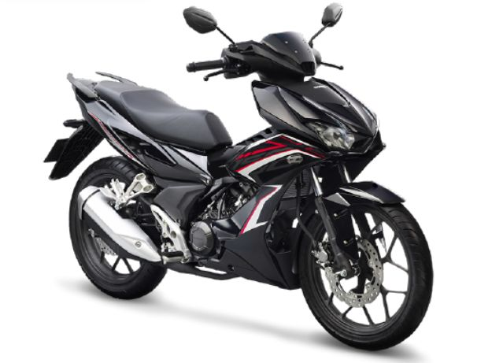

[🏠 Trang chủ](../../README.md) › [Winner](../../dong-xe/winner.md) › **BO0858**

# BO0858 · WinnerX 150 2020 V2 Đen - Phiên bản Thể Thao (Phanh Thường) (NH-B25M)

| | |
|---|---|
| **Mã bộ** | `BO0858` |
| **Tên bộ** | Bộ nhựa (Dàn áo) WinnerX 150 2020 V2 Đen - Phiên bản Thể Thao (Phanh Thường) (NH-B25M) |
| **Đời xe** | Winner X 150 năm 2020 Đen - Phiên bản Thể Thao (Phanh Thường) (NH-B25M) |
| **Model** | WI6 |
| **Dòng xe** | Winner |
| **Số chi tiết** | 38 |

## Chi tiết trong bộ

| STT | Mã chi tiết | Tên chi tiết | Dùng chung | Mã thay thế | Ghi chú |
|---:|---|---|:---:|---|---|
| 1 | [`64315K56V60ZE`](../../tra-ma/6431.md#64315k56v60ze) | Ốp trên mặt nạ xe \*NHB25B\* |  |  |  |
| 2 | [`64650K2PV10ZB`](../../tra-ma/6465.md#64650k2pv10zb) | Bộ ốp sườn trái \*TYPE3\* \*NHB25B\* |  |  |  |
| 3 | [`64600K2PV10ZB`](../../tra-ma/6460.md#64600k2pv10zb) | Bộ ốp sườn phải \*TYPE3\* \*NHB25B\* |  |  |  |
| 4 | [`64471K2PV10ZB`](../../tra-ma/6447.md#64471k2pv10zb) | Bộ ốp sườn trung tâm \*TYPE 3\* \*NHB25B\* \* |  |  |  |
| 5 | [`64300K56V50ZA`](../../tra-ma/6430.md#64300k56v50za) | Bộ mặt nạ trước \*TYPE1\* | ✔ |  |  |
| 6 | [`64450K2PV10ZB`](../../tra-ma/6445.md#64450k2pv10zb) | Bộ ốp sườn sau trái \*TYPE3\* \*NHB25B\* |  |  |  |
| 7 | [`64400K2PV10ZB`](../../tra-ma/6440.md#64400k2pv10zb) | Bộ ốp sườn sau phải \*TYPE3\* \*NHB25B\* |  |  |  |
| 8 | [`64320K56V50ZA`](../../tra-ma/6432.md#64320k56v50za) | Ốp ống yếm chính  \*NH1\* | ✔ |  |  |
| 9 | [`53207K56V50ZK`](../../tra-ma/5320.md#53207k56v50zk) | Nắp trên tay lái \*NHB25B\* \*NHB25H\* |  |  |  |
| 10 | [`64440K56V50ZA`](../../tra-ma/6444.md#64440k56v50za) | Ốp trong thân bên trái \*NH1\* | ✔ |  |  |
| 11 | [`64360K56V50ZG`](../../tra-ma/6436.md#64360k56v50zg) | Ốp nhựa trước trái \*NHB25B\* \*NHB25H\* \*PB |  |  |  |
| 12 | [`50706K56V50ZC`](../../tra-ma/507.md#50706k56v50zc) | Tấm bảo vệ giá để chân trái \*NHA76M\* |  |  |  |
| 13 | [`64328K56V50ZM`](../../tra-ma/6432.md#64328k56v50zm) | Bộ ốp ống yếm sau trái \*NHA76\* \*NHB25B\* |  |  |  |
| 14 | [`64430K56V50ZA`](../../tra-ma/6443.md#64430k56v50za) | Ốp trong thân bên phải \*NH1\* | ✔ |  |  |
| 15 | [`64350K56V50ZG`](../../tra-ma/6435.md#64350k56v50zg) | Ốp nhựa trước phải \*NHB25B\* \*NHB25H\* \*PB |  |  |  |
| 16 | [`50606K56V50ZC`](../../tra-ma/506.md#50606k56v50zc) | Tấm bảo vệ phải \*NHA76M\* | ✔ |  |  |
| 17 | [`64327K56V50ZM`](../../tra-ma/6432.md#64327k56v50zm) | Bộ ốp ống yếm sau phải \*NHA76\* \*NHB25B\* |  |  |  |
| 18 | [`53206K56V50ZA`](../../tra-ma/5320.md#53206k56v50za) | Nắp sau tay lái \*NH1\* | ✔ |  |  |
| 19 | [`61100K56V50ZG`](../../tra-ma/611.md#61100k56v50zg) | Bộ chắn bùn A trước \*NHB25B\* \*NHB25H\* |  |  |  |
| 20 | [`50707K56V50`](../../tra-ma/507.md#50707k56v50) | Bảo vệ để chân trái |  |  |  |
| 21 | [`53205K56V50`](../../tra-ma/5320.md#53205k56v50) | Nắp trước tay lái |  |  |  |
| 22 | [`53306K56V50`](../../tra-ma/533.md#53306k56v50) | Nắp sau tay lái trên |  |  |  |
| 23 | [`61200K56V50`](../../tra-ma/612.md#61200k56v50) | Chắn bùn B trước |  |  |  |
| 24 | [`64510K56V50`](../../tra-ma/645.md#64510k56v50) | Bộ ốp yếm phải |  |  |  |
| 25 | [`64520K56V50`](../../tra-ma/645.md#64520k56v50) | Bộ ốp yếm trái |  |  |  |
| 26 | [`64625K56V50`](../../tra-ma/6462.md#64625k56v50) | Ốp sườn trái B |  |  |  |
| 27 | [`64630K56V50`](../../tra-ma/6463.md#64630k56v50) | Ốp yếm dưới |  |  |  |
| 28 | [`64660K56V50`](../../tra-ma/6466.md#64660k56v50) | Ốp yếm dưới phải |  |  |  |
| 29 | [`64670K56V50`](../../tra-ma/6467.md#64670k56v50) | Ốp yếm dưới trái |  |  |  |
| 30 | [`80100K56V50`](../../tra-ma/8010.md#80100k56v50) | Chắn bùn sau trên |  |  |  |
| 31 | [`80110K56V00`](../../tra-ma/8011.md#80110k56v00) | Chắn bùn sau dưới |  |  |  |
| 32 | [`50197K56V50`](../../tra-ma/501.md#50197k56v50) |  |  |  |  |
| 33 | [`50607K56V50`](../../tra-ma/506.md#50607k56v50) |  |  |  |  |
| 34 | [`53209K56V50`](../../tra-ma/5320.md#53209k56v50) |  |  |  |  |
| 35 | [`64615K56V50`](../../tra-ma/6461.md#64615k56v50) |  |  |  |  |
| 36 | [`83520K56V50`](../../tra-ma/8352.md#83520k56v50) |  |  |  |  |
| 37 | [`83525K56V50`](../../tra-ma/8352.md#83525k56v50) |  |  |  |  |
| 38 | [`80150K56V50`](../../tra-ma/8015.md#80150k56v50) | Chắn bùn B sau |  |  |  |

## Mã thiếu bổ sung

_Không tính sẵn trong bộ, thêm khi khách cần._

| Mã | Tên |
|---|---|
| [`50197K56V50`](../../tra-ma/501.md#50197k56v50) | Giá đỡ tay lái |
| [`50607K56V50`](../../tra-ma/506.md#50607k56v50) | Nắp hộp bình ắc quy |
| [`53209K56V50`](../../tra-ma/5320.md#53209k56v50) | Giã giữ đồng hồ tốc độ |
| [`64615K56V50`](../../tra-ma/6461.md#64615k56v50) | Nắp bình chứa nước làm mát |
| [`83520K56V50`](../../tra-ma/8352.md#83520k56v50) | Nắp đèn hậu phải |
| [`83525K56V50`](../../tra-ma/8352.md#83525k56v50) | Nắp đèn hậu trái |

Cập nhật 11/11/2026
