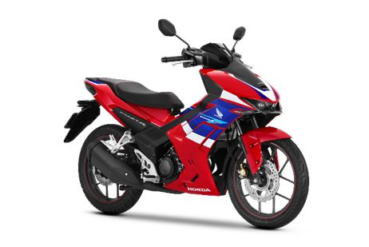

[🏠 Trang chủ](../../README.md) › [Winner](../../dong-xe/winner.md) › **BO1030**

# BO1030 · Winner R 2026 đỏ đen R389 bản thể thao

| | |
|---|---|
| **Mã bộ** | `BO1030` |
| **Tên bộ** | Bộ nhựa (Dàn áo) Winner R 2026 đỏ đen R389 bản thể thao |
| **Đời xe** | Winner R 2026 thể thao Đỏ đen R389 |
| **Model** | FS150FA (FS150FAT)…………2V |
| **Dòng xe** | Winner |
| **Số chi tiết** | 34 |

## Chi tiết trong bộ

| STT | Mã chi tiết | Tên chi tiết | Dùng chung | Mã thay thế | Ghi chú |
|---:|---|---|:---:|---|---|
| 1 | [`50197K2PVH0`](../../tra-ma/501.md#50197k2pvh0) | ỐP BẢN LỀ YÊN XE |  |  |  |
| 2 | [`50610K2PVJ0ZA`](../../tra-ma/506.md#50610k2pvj0za) | GIÁ ĐỠ ĐỂ CHÂN PHẢI \*NH1\* |  |  |  |
| 3 | [`50710K2PVJ0ZA`](../../tra-ma/507.md#50710k2pvj0za) | GIÁ ĐỠ ĐỂ CHÂN TRÁI \*NH1\* |  |  |  |
| 4 | [`50807K2PVH0`](../../tra-ma/508.md#50807k2pvh0) | NẮP HỘP BÌNH ẮC QUY |  |  |  |
| 5 | [`53205K2PVH0`](../../tra-ma/5320.md#53205k2pvh0) | NẮP TRƯỚC TAY LÁI |  |  |  |
| 6 | [`53207K2PVH0ZA`](../../tra-ma/5320.md#53207k2pvh0za) | NẮP TRÊN TAY LÁI PHẢI \*NHB25M\* |  |  |  |
| 7 | [`53209K2PVH0`](../../tra-ma/5320.md#53209k2pvh0) | GIÁ GIỮ ĐỒNG HỒ TỐC ĐỘ |  |  |  |
| 8 | [`53250K2PVH0`](../../tra-ma/5325.md#53250k2pvh0) | BỘ ỐP NHỰA SAU TAY LÁI |  |  |  |
| 9 | [`61000K2PVJ0ZE`](../../tra-ma/610.md#61000k2pvj0ze) | BỘ CHẶN BÙN TRƯỚC \*R389\* |  |  |  |
| 10 | [`61200K56V50`](../../tra-ma/612.md#61200k56v50) | Chắn bùn B trước |  |  |  |
| 11 | [`64300K2PVH0ZA`](../../tra-ma/6430.md#64300k2pvh0za) | BỘ TẤM CHẮN MẶT ĐỒNG HỒ TỐC ĐỘ\*TYPE1\* |  |  |  |
| 12 | [`64302K2PVH0`](../../tra-ma/6430.md#64302k2pvh0) | ỐP TRƯỚC BÊN TRONG |  |  |  |
| 13 | [`64310K2PVK0ZA`](../../tra-ma/6431.md#64310k2pvk0za) | BỘ ỐP MẶT NẠ TRƯỚC \*R389\* |  |  |  |
| 14 | [`64320K2PVJ0`](../../tra-ma/6432.md#64320k2pvj0) | ỐP ỐNG YẾM CHÍNH |  |  |  |
| 15 | [`64325K2PVK0ZA`](../../tra-ma/6432.md#64325k2pvk0za) | BỘ ỐP YẾM SAU PHẢI \*R389\* |  |  |  |
| 16 | [`64326K2PVK0ZA`](../../tra-ma/6432.md#64326k2pvk0za) | BỘ ỐP YẾM SAU TRÁI \*R389\* |  |  |  |
| 17 | [`64335K2PVH0`](../../tra-ma/6433.md#64335k2pvh0) | ỐP KHÓA KHẨN CẤP |  |  |  |
| 18 | [`64336K2PVH0`](../../tra-ma/6433.md#64336k2pvh0) | ỐP BỘ ĐIỀU KHIỂN ĐỘNG CƠ |  |  |  |
| 19 | [`64400K2PVK0ZA`](../../tra-ma/6440.md#64400k2pvk0za) | BỘ ỐP SƯỜN PHẢI \*R389\* |  |  |  |
| 20 | [`64450K2PVK0ZA`](../../tra-ma/6445.md#64450k2pvk0za) | BỘ ỐP SƯỜN TRÁI \*R389\* |  |  |  |
| 21 | [`64471K2PVH0ZA`](../../tra-ma/6447.md#64471k2pvh0za) | BỘ ỐP SƯỜN TRUNG TÂM \*NH1\* |  |  |  |
| 22 | [`64510K2PVH0`](../../tra-ma/645.md#64510k2pvh0) | ỐP TRONG PHẢI |  |  |  |
| 23 | [`64520K2PVH0`](../../tra-ma/645.md#64520k2pvh0) | ỐP TRONG TRÁI |  |  |  |
| 24 | [`64600K2PVK0ZA`](../../tra-ma/6460.md#64600k2pvk0za) | BỘ ỐP TRƯỚC PHẢI \*R389\* |  |  |  |
| 25 | [`64611K2PVH0`](../../tra-ma/6461.md#64611k2pvh0) | ỐP SƯỜN PHẢI B |  |  |  |
| 26 | [`64621K2PVH0`](../../tra-ma/6462.md#64621k2pvh0) | ỐP SƯỜN TRÁI B |  |  |  |
| 27 | [`64630K2PVH0`](../../tra-ma/6463.md#64630k2pvh0) | ỐP YẾM DƯỚI |  |  |  |
| 28 | [`64650K2PVK0ZA`](../../tra-ma/6465.md#64650k2pvk0za) | BỘ ỐP TRƯỚC TRÁI \*R389\* |  |  |  |
| 29 | [`64665K2PVK0ZA`](../../tra-ma/6466.md#64665k2pvk0za) | BỘ ỐP C BÊN PHẢI \*R389\* |  |  |  |
| 30 | [`64675K2PVK0ZA`](../../tra-ma/6467.md#64675k2pvk0za) | BỘ ỐP C BÊN TRÁI \*R389\* |  |  |  |
| 31 | [`80100K2PVH0`](../../tra-ma/8010.md#80100k2pvh0) | CHẮN BÙN SAU TRÊN |  |  |  |
| 32 | [`80110K2PVE0`](../../tra-ma/8011.md#80110k2pve0) | Miếng nối đèn soi biển số |  |  |  |
| 33 | [`80110K2PVH0`](../../tra-ma/8011.md#80110k2pvh0) | CHẮN BÙN SAU DƯỚI |  |  |  |
| 34 | [`80150K2PVH0`](../../tra-ma/8015.md#80150k2pvh0) | CHẮN BÙN SAU BÊN TRONG |  |  |  |

Cập nhật 11/11/2026
