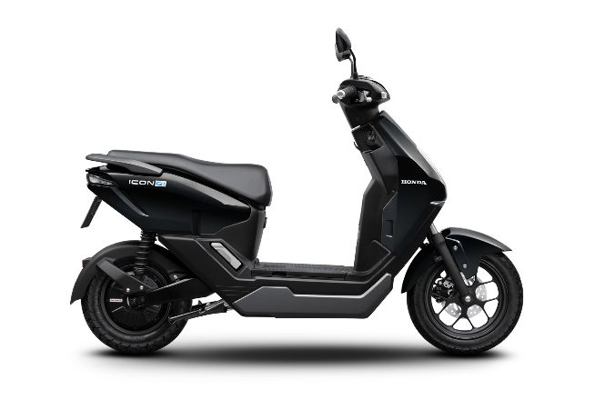
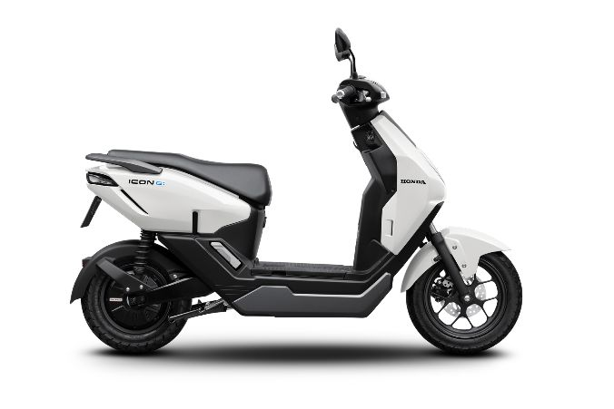
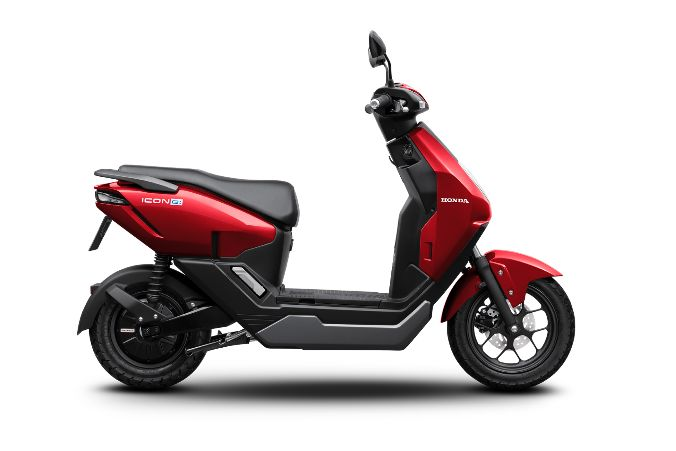
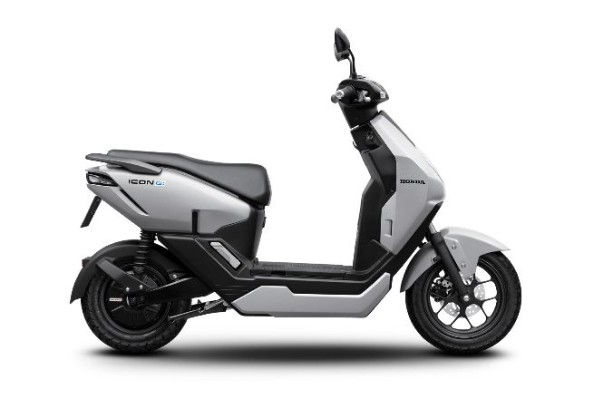
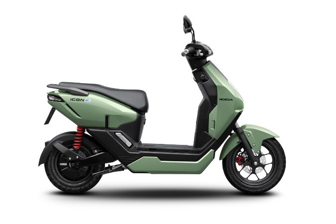
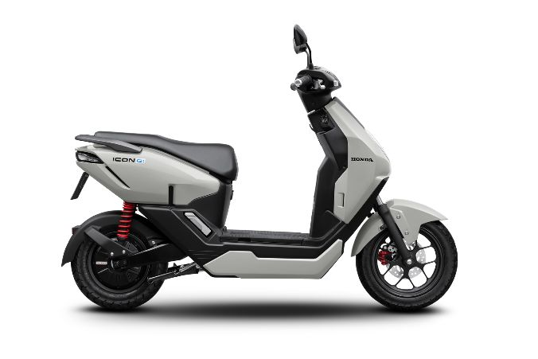

[🏠 Trang chủ](../README.md) › **Icon E**

# Bộ Nhựa Icon E

6 đời/màu xe. Bấm vào ảnh hoặc mã bộ để xem danh sách chi tiết.

<table>
<tr>
<td align="center" valign="top" width="33%"> <b>Icon E 2025 đen NHB25 bản cao cấp</b> <a href="../bo/icon-e/BO1061-icon-e-2025-den-nhb25-ban-cao-cap.md"><code>BO1061</code></a></td>
<td align="center" valign="top" width="33%"> <b>Icon E 2025 đen NHB25 bản cao cấp</b> <a href="../bo/icon-e/BO1062-icon-e-2025-den-nhb25-ban-cao-cap.md"><code>BO1062</code></a></td>
<td align="center" valign="top" width="33%"> <b>Icon E 2025 đỏ R368 bản cao cấp</b> <a href="../bo/icon-e/BO1063-icon-e-2025-do-r368-ban-cao-cap.md"><code>BO1063</code></a></td>
</tr>
<tr>
<td align="center" valign="top" width="33%"> <b>Icon E 2025 xám NHB18 bản đặc biệt</b> <a href="../bo/icon-e/BO1064-icon-e-2025-xam-nhb18-ban-dac-biet.md"><code>BO1064</code></a></td>
<td align="center" valign="top" width="33%"> <b>Icon E 2025 xanh GY163</b> <a href="../bo/icon-e/BO1065-icon-e-2025-xanh-gy163.md"><code>BO1065</code></a></td>
<td align="center" valign="top" width="33%"> <b>Icon E 2025 xanh GY163</b> <a href="../bo/icon-e/BO1066-icon-e-2025-xanh-gy163.md"><code>BO1066</code></a></td>
</tr>
</table>
