[🏠 Trang chủ](../README.md) › **SH**

# Bộ Nhựa Sh

114 đời/màu xe. Bấm vào ảnh hoặc mã bộ để xem danh sách chi tiết.

<table>
<tr>
<td align="center" valign="top" width="33%"> <b>SH125&150 2009 KTF màu bạc NHB24M</b> <a href="../bo/sh/BO0319-sh125-150-2009-ktf-mau-bac-nhb24m.md"><code>BO0319</code></a></td>
<td align="center" valign="top" width="33%"> <b>SH125&150 2009 KTF màu bạc NHB24M</b> <a href="../bo/sh/BO0319.1-sh125-150-2009-ktf-mau-bac-nhb24m.md"><code>BO0319.1</code></a></td>
<td align="center" valign="top" width="33%"><a href="../bo/sh/BO0320-sh125-150-2009-ktf-den-nhb25m.md">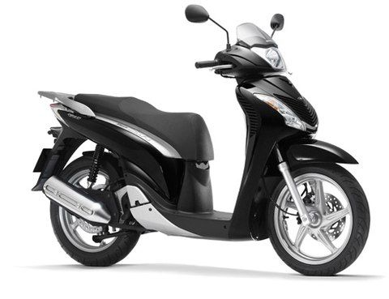</a> <b>SH125&150 2009 KTF Đen NHB25M</b> <a href="../bo/sh/BO0320-sh125-150-2009-ktf-den-nhb25m.md"><code>BO0320</code></a></td>
</tr>
<tr>
<td align="center" valign="top" width="33%"> <b>SH125&150 2009 KTF Đen NHB25M</b> <a href="../bo/sh/BO0320.1-sh125-150-2009-ktf-den-nhb25m.md"><code>BO0320.1</code></a></td>
<td align="center" valign="top" width="33%"><a href="../bo/sh/BO0321-sh125-150-2009-ktf-nau-nhat-y208.md">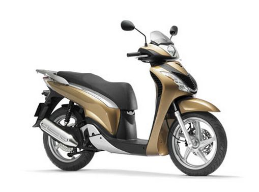</a> <b>SH125&150 2009 KTF Nâu (nhạt) Y208</b> <a href="../bo/sh/BO0321-sh125-150-2009-ktf-nau-nhat-y208.md"><code>BO0321</code></a></td>
<td align="center" valign="top" width="33%"> <b>SH125&150 2009 KTF Nâu (nhạt) Y208</b> <a href="../bo/sh/BO0321.1-sh125-150-2009-ktf-nau-nhat-y208.md"><code>BO0321.1</code></a></td>
</tr>
<tr>
<td align="center" valign="top" width="33%"> <b>SH125&150 2009 KTF Nâu (Đậm) YR303</b> <a href="../bo/sh/BO0322-sh125-150-2009-ktf-nau-dam-yr303.md"><code>BO0322</code></a></td>
<td align="center" valign="top" width="33%"><a href="../bo/sh/BO0322.1-sh125-150-2009-ktf-nau-dam-yr303.md">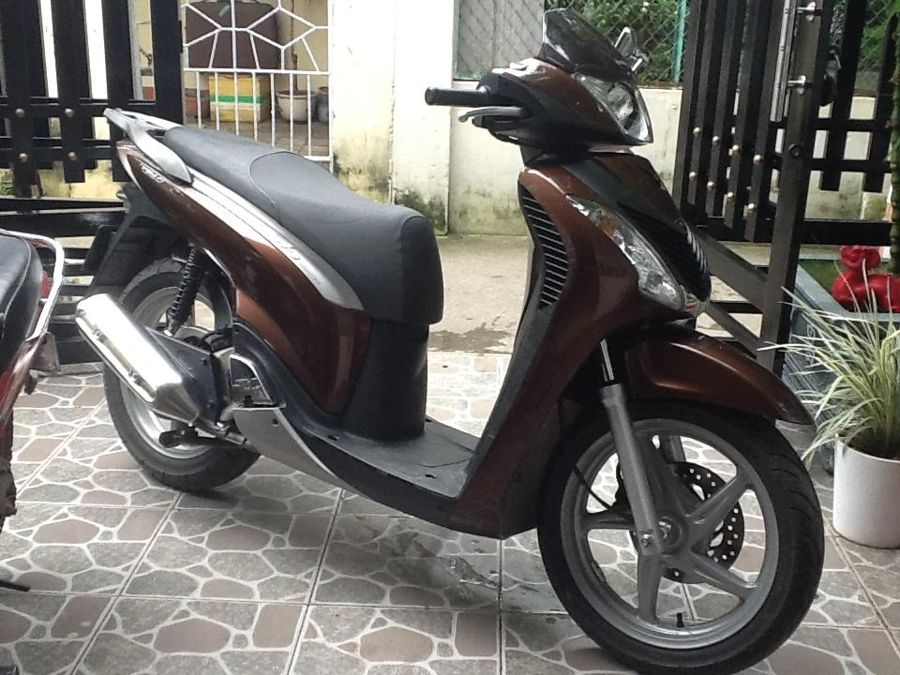</a> <b>SH125&150 2009 KTF Nâu (Đậm) YR303</b> <a href="../bo/sh/BO0322.1-sh125-150-2009-ktf-nau-dam-yr303.md"><code>BO0322.1</code></a></td>
<td align="center" valign="top" width="33%"><a href="../bo/sh/BO0323-sh125-150-2009-ktf-trang-nh35p.md">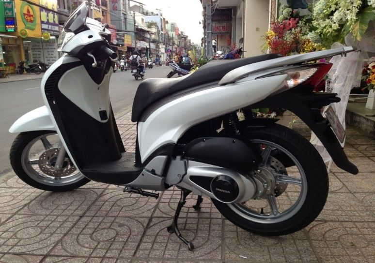</a> <b>SH125&150 2009 KTF Trắng NH35P</b> <a href="../bo/sh/BO0323-sh125-150-2009-ktf-trang-nh35p.md"><code>BO0323</code></a></td>
</tr>
<tr>
<td align="center" valign="top" width="33%"> <b>SH125&150 2009 KTF Trắng NH35P</b> <a href="../bo/sh/BO0323.1-sh125-150-2009-ktf-trang-nh35p.md"><code>BO0323.1</code></a></td>
<td align="center" valign="top" width="33%"> <b>SH125&150 2009 KTF Đỏ (Sẫm) R350c</b> <a href="../bo/sh/BO0324-sh125-150-2009-ktf-do-sam-r350c.md"><code>BO0324</code></a></td>
<td align="center" valign="top" width="33%"><a href="../bo/sh/BO0324.1-sh125-150-2009-ktf-do-sam-r350c.md">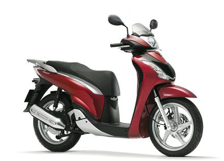</a> <b>SH125&150 2009 KTF Đỏ (Sẫm) R350c</b> <a href="../bo/sh/BO0324.1-sh125-150-2009-ktf-do-sam-r350c.md"><code>BO0324.1</code></a></td>
</tr>
<tr>
<td align="center" valign="top" width="33%"><a href="../bo/sh/BO0325-sh125-2012-k01-den-nhb25.md">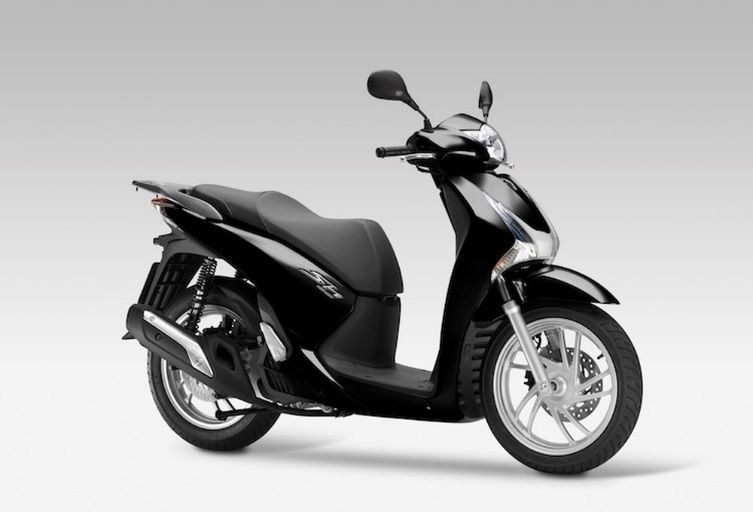</a> <b>SH125 2012 K01 Đen NHB25</b> <a href="../bo/sh/BO0325-sh125-2012-k01-den-nhb25.md"><code>BO0325</code></a></td>
<td align="center" valign="top" width="33%"> <b>SH150 2012 K01 Đen NHB25</b> <a href="../bo/sh/BO0325.1-sh150-2012-k01-den-nhb25.md"><code>BO0325.1</code></a></td>
<td align="center" valign="top" width="33%"><a href="../bo/sh/BO0326-sh125-2012-k01-trang-nhb35.md">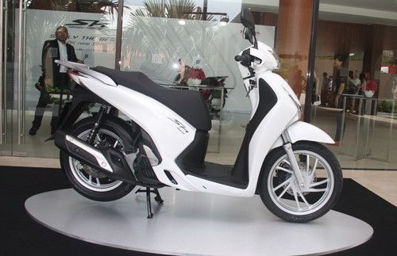</a> <b>SH125 2012 K01 Trắng NHB35</b> <a href="../bo/sh/BO0326-sh125-2012-k01-trang-nhb35.md"><code>BO0326</code></a></td>
</tr>
<tr>
<td align="center" valign="top" width="33%"> <b>SH150 2012 K01 Trắng NHB35</b> <a href="../bo/sh/BO0326.1-sh150-2012-k01-trang-nhb35.md"><code>BO0326.1</code></a></td>
<td align="center" valign="top" width="33%"> <b>SH125 2012 K01 đỏ sẫm R350</b> <a href="../bo/sh/BO0327-sh125-2012-k01-do-sam-r350.md"><code>BO0327</code></a></td>
<td align="center" valign="top" width="33%"><a href="../bo/sh/BO0327.1-sh150-2012-k01-do-sam-r350.md">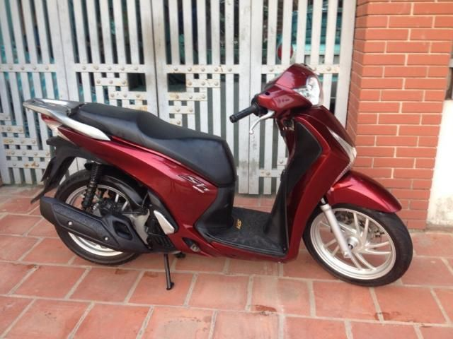</a> <b>SH150 2012 K01 đỏ sẫm R350</b> <a href="../bo/sh/BO0327.1-sh150-2012-k01-do-sam-r350.md"><code>BO0327.1</code></a></td>
</tr>
<tr>
<td align="center" valign="top" width="33%"><a href="../bo/sh/BO0328-sh125-2012-k01-nau-dam-yr-303.md">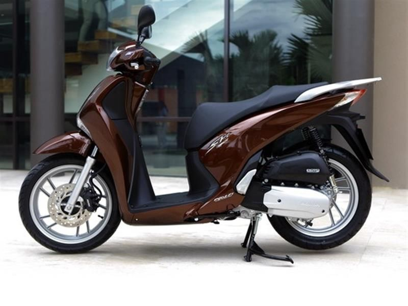</a> <b>SH125 2012 K01 Nâu đậm YR 303</b> <a href="../bo/sh/BO0328-sh125-2012-k01-nau-dam-yr-303.md"><code>BO0328</code></a></td>
<td align="center" valign="top" width="33%"> <b>SH150 2012 K01 Nâu đậm YR 303</b> <a href="../bo/sh/BO0328.1-sh150-2012-k01-nau-dam-yr-303.md"><code>BO0328.1</code></a></td>
<td align="center" valign="top" width="33%"> <b>SH125 2012 K01 Xám YR 320</b> <a href="../bo/sh/BO0329-sh125-2012-k01-xam-yr-320.md"><code>BO0329</code></a></td>
</tr>
<tr>
<td align="center" valign="top" width="33%"><a href="../bo/sh/BO0329.1-sh150-2012-k01-xam-yr-320.md">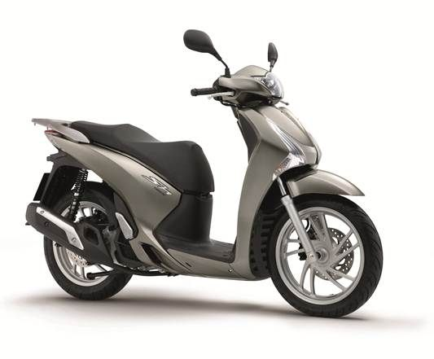</a> <b>SH150 2012 K01 Xám YR 320</b> <a href="../bo/sh/BO0329.1-sh150-2012-k01-xam-yr-320.md"><code>BO0329.1</code></a></td>
<td align="center" valign="top" width="33%"><a href="../bo/sh/BO0330-sh125-2013-k01-den-nhb25.md">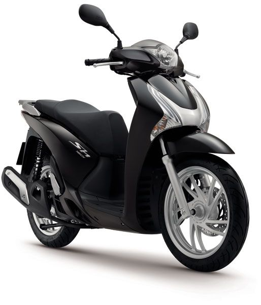</a> <b>SH125 2013 K01 đen NHB25</b> <a href="../bo/sh/BO0330-sh125-2013-k01-den-nhb25.md"><code>BO0330</code></a></td>
<td align="center" valign="top" width="33%"> <b>SH150 2013 K01 đen NHB25</b> <a href="../bo/sh/BO0330.1-sh150-2013-k01-den-nhb25.md"><code>BO0330.1</code></a></td>
</tr>
<tr>
<td align="center" valign="top" width="33%"><a href="../bo/sh/BO0331-sh125-2013-k01-trang-nhb35.md">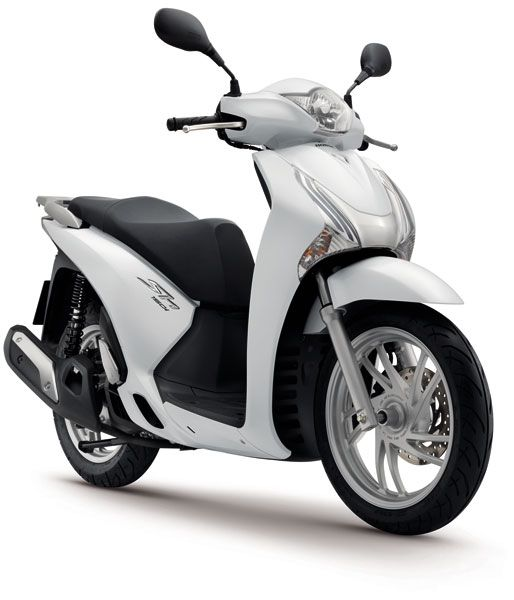</a> <b>SH125 2013 K01 trắng NHB35</b> <a href="../bo/sh/BO0331-sh125-2013-k01-trang-nhb35.md"><code>BO0331</code></a></td>
<td align="center" valign="top" width="33%"> <b>SH150 2013 K01 trắng NHB35</b> <a href="../bo/sh/BO0331.1-sh150-2013-k01-trang-nhb35.md"><code>BO0331.1</code></a></td>
<td align="center" valign="top" width="33%"> <b>SH125 2013 K01 Xanh PB 390</b> <a href="../bo/sh/BO0332-sh125-2013-k01-xanh-pb-390.md"><code>BO0332</code></a></td>
</tr>
<tr>
<td align="center" valign="top" width="33%"><a href="../bo/sh/BO0332.1-sh150-2013-k01-xanh-pb-390.md">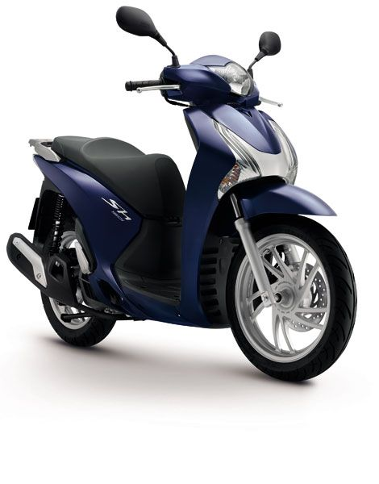</a> <b>SH150 2013 K01 Xanh PB 390</b> <a href="../bo/sh/BO0332.1-sh150-2013-k01-xanh-pb-390.md"><code>BO0332.1</code></a></td>
<td align="center" valign="top" width="33%"><a href="../bo/sh/BO0333-sh125-2013-k01-do-den-r340.md">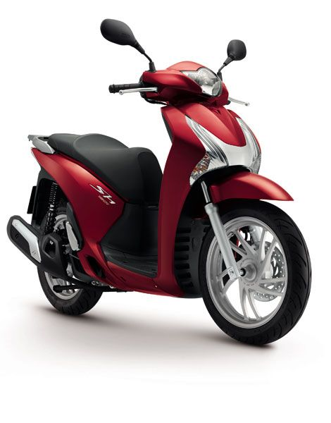</a> <b>SH125 2013 K01 đỏ đen R340</b> <a href="../bo/sh/BO0333-sh125-2013-k01-do-den-r340.md"><code>BO0333</code></a></td>
<td align="center" valign="top" width="33%"> <b>SH150 2013 K01 đỏ đen R340</b> <a href="../bo/sh/BO0333.1-sh150-2013-k01-do-den-r340.md"><code>BO0333.1</code></a></td>
</tr>
<tr>
<td align="center" valign="top" width="33%"> <b>SH125 2013 K01 đỏ sậm R350</b> <a href="../bo/sh/BO0334-sh125-2013-k01-do-sam-r350.md"><code>BO0334</code></a></td>
<td align="center" valign="top" width="33%"><a href="../bo/sh/BO0334.1-sh125-150-2013-k01-do-sam-r350.md">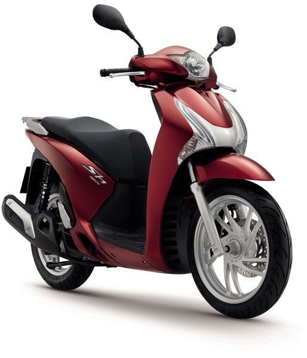</a> <b>SH125&150 2013 K01 đỏ sậm R350</b> <a href="../bo/sh/BO0334.1-sh125-150-2013-k01-do-sam-r350.md"><code>BO0334.1</code></a></td>
<td align="center" valign="top" width="33%"><a href="../bo/sh/BO0335-sh125-2013-k01-xam-yr320.md">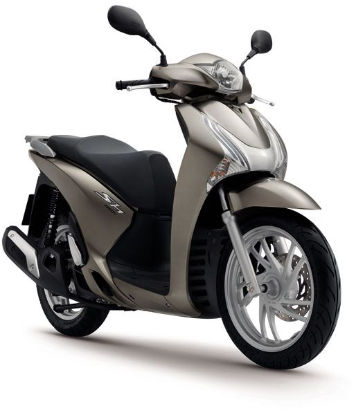</a> <b>SH125 2013 K01 Xám YR320</b> <a href="../bo/sh/BO0335-sh125-2013-k01-xam-yr320.md"><code>BO0335</code></a></td>
</tr>
<tr>
<td align="center" valign="top" width="33%"> <b>SH125&150 2013 K01 Xám YR320</b> <a href="../bo/sh/BO0335.1-sh125-150-2013-k01-xam-yr320.md"><code>BO0335.1</code></a></td>
<td align="center" valign="top" width="33%"><a href="../bo/sh/BO0336-sh125-2015-k01-den-nhb25.md">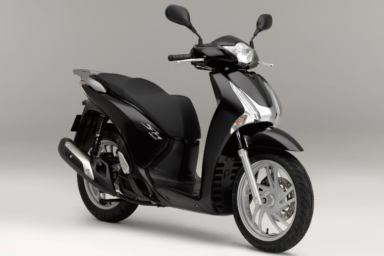</a> <b>SH125 2015 K01 Đen NHB25</b> <a href="../bo/sh/BO0336-sh125-2015-k01-den-nhb25.md"><code>BO0336</code></a></td>
<td align="center" valign="top" width="33%"> <b>SH150 2015 K01 Đen NHB25</b> <a href="../bo/sh/BO0336.1-sh150-2015-k01-den-nhb25.md"><code>BO0336.1</code></a></td>
</tr>
<tr>
<td align="center" valign="top" width="33%"><a href="../bo/sh/BO0337-sh125-2015-k01-trang-nhb35.md">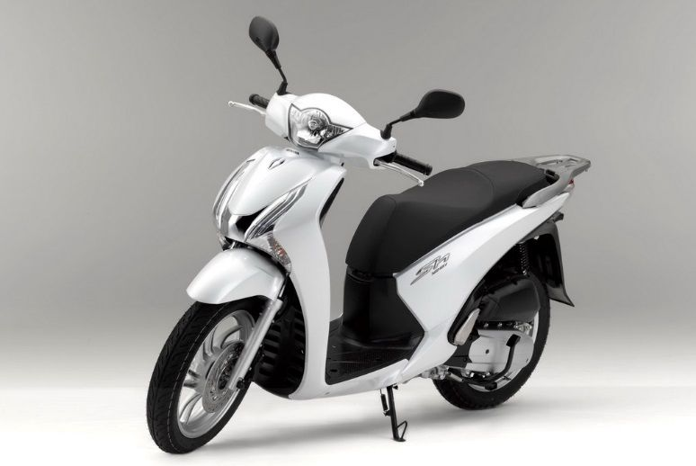</a> <b>SH125 2015 K01 Trắng NHB35</b> <a href="../bo/sh/BO0337-sh125-2015-k01-trang-nhb35.md"><code>BO0337</code></a></td>
<td align="center" valign="top" width="33%"> <b>SH150 2015 K01 Trắng NHB35</b> <a href="../bo/sh/BO0337.1-sh150-2015-k01-trang-nhb35.md"><code>BO0337.1</code></a></td>
<td align="center" valign="top" width="33%"><a href="../bo/sh/BO0338-sh125-2015-k01-do-sam-r340.md">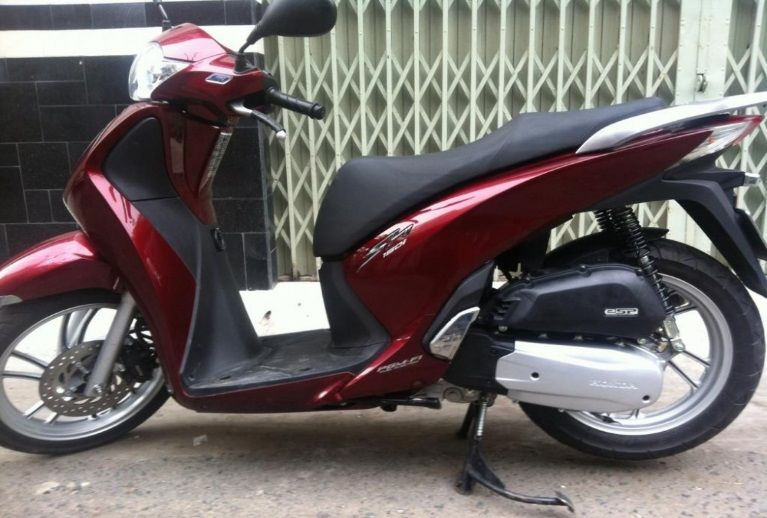</a> <b>SH125 2015 K01 Đỏ Sẫm R340</b> <a href="../bo/sh/BO0338-sh125-2015-k01-do-sam-r340.md"><code>BO0338</code></a></td>
</tr>
<tr>
<td align="center" valign="top" width="33%"> <b>SH150 2015 K01 Đỏ Sẫm R340</b> <a href="../bo/sh/BO0338.1-sh150-2015-k01-do-sam-r340.md"><code>BO0338.1</code></a></td>
<td align="center" valign="top" width="33%"><a href="../bo/sh/BO0339-sh125-2015-k01-xanh-luc-g209.md">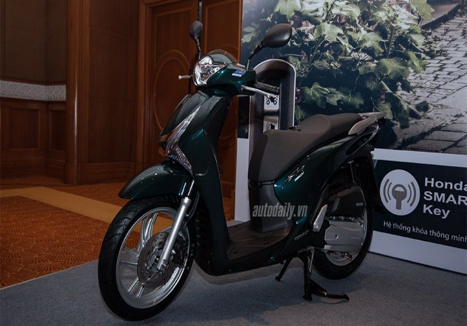</a> <b>SH125 2015 K01 Xanh lục G209</b> <a href="../bo/sh/BO0339-sh125-2015-k01-xanh-luc-g209.md"><code>BO0339</code></a></td>
<td align="center" valign="top" width="33%"> <b>SH150 2015 K01 Xanh lục G209</b> <a href="../bo/sh/BO0339.1-sh150-2015-k01-xanh-luc-g209.md"><code>BO0339.1</code></a></td>
</tr>
<tr>
<td align="center" valign="top" width="33%"><a href="../bo/sh/BO0340-sh125-2015-k01-xanh-lam-pb403.md">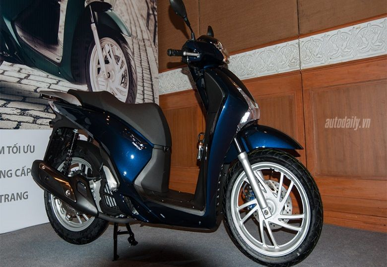</a> <b>SH125 2015 K01 Xanh lam PB403</b> <a href="../bo/sh/BO0340-sh125-2015-k01-xanh-lam-pb403.md"><code>BO0340</code></a></td>
<td align="center" valign="top" width="33%"> <b>SH150 2015 K01 Xanh lam PB403</b> <a href="../bo/sh/BO0340.1-sh150-2015-k01-xanh-lam-pb403.md"><code>BO0340.1</code></a></td>
<td align="center" valign="top" width="33%"><a href="../bo/sh/BO0341-sh125-2016-k77-den-nhb25-phanh-cbs-khac-de.md">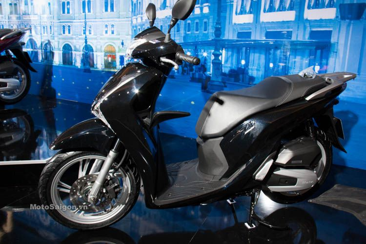</a> <b>SH125 2016 K77 Đen NHB25 phanh CBS (khác dè)</b> <a href="../bo/sh/BO0341-sh125-2016-k77-den-nhb25-phanh-cbs-khac-de.md"><code>BO0341</code></a></td>
</tr>
<tr>
<td align="center" valign="top" width="33%"> <b>SH150 2016 K77 Đen NHB25 phanh ABS (khác dè)</b> <a href="../bo/sh/BO0341.1-sh150-2016-k77-den-nhb25-phanh-abs-khac-de.md"><code>BO0341.1</code></a></td>
<td align="center" valign="top" width="33%"> <b>SH125 2016 K77 Trắng NHB35 phanh CBS (khác dè)</b> <a href="../bo/sh/BO0342-sh125-2016-k77-trang-nhb35-phanh-cbs-khac-de.md"><code>BO0342</code></a></td>
<td align="center" valign="top" width="33%"><a href="../bo/sh/BO0342.1-sh150-2016-k77-trang-nhb35-phanh-abs-khac-de.md">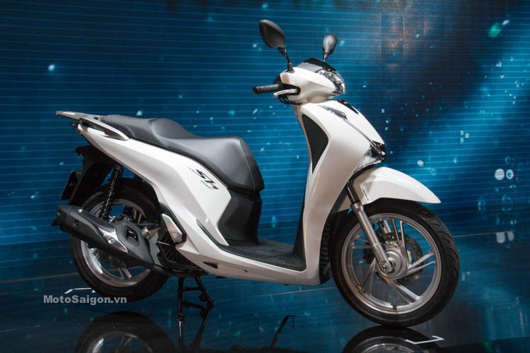</a> <b>SH150 2016 K77 Trắng NHB35 phanh ABS (khác dè)</b> <a href="../bo/sh/BO0342.1-sh150-2016-k77-trang-nhb35-phanh-abs-khac-de.md"><code>BO0342.1</code></a></td>
</tr>
<tr>
<td align="center" valign="top" width="33%"><a href="../bo/sh/BO0343-sh125-2016-k77-xanh-luc-g209-phanh-cbs-khac-de.md">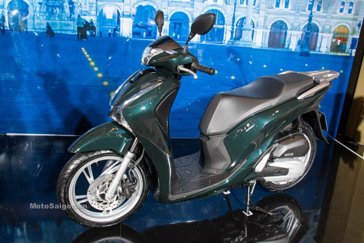</a> <b>SH125 2016 K77 Xanh Lục G209 phanh CBS (Khác dè)</b> <a href="../bo/sh/BO0343-sh125-2016-k77-xanh-luc-g209-phanh-cbs-khac-de.md"><code>BO0343</code></a></td>
<td align="center" valign="top" width="33%"> <b>SH150 2016 K77 Xanh Lục G209 phanh ABS (khác dè)</b> <a href="../bo/sh/BO0343.1-sh150-2016-k77-xanh-luc-g209-phanh-abs-khac-de.md"><code>BO0343.1</code></a></td>
<td align="center" valign="top" width="33%"> <b>SH125 2018 K77 Màu Đen Mờ - NHA76M</b> <a href="../bo/sh/BO0867-sh125-2018-k77-mau-den-mo-nha76m.md"><code>BO0867</code></a></td>
</tr>
<tr>
<td align="center" valign="top" width="33%"><a href="../bo/sh/BO0344-sh125-2016-k77-xanh-lam-pb403-phanh-cbs-khac-de.md">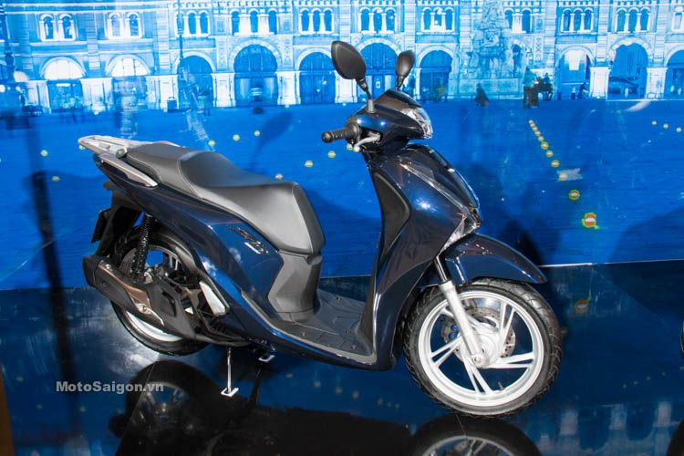</a> <b>SH125 2016 K77 Xanh Lam PB403 phanh CBS (khác dè)</b> <a href="../bo/sh/BO0344-sh125-2016-k77-xanh-lam-pb403-phanh-cbs-khac-de.md"><code>BO0344</code></a></td>
<td align="center" valign="top" width="33%"> <b>SH125 2016 K77 Xanh Lam PB403 phanh ABS (khác dè)</b> <a href="../bo/sh/BO0344.1-sh125-2016-k77-xanh-lam-pb403-phanh-abs-khac-de.md"><code>BO0344.1</code></a></td>
<td align="center" valign="top" width="33%"> <b>SH125 2016 K77 Đỏ R368 phanh CBS (khác dè)</b> <a href="../bo/sh/BO0345-sh125-2016-k77-do-r368-phanh-cbs-khac-de.md"><code>BO0345</code></a></td>
</tr>
<tr>
<td align="center" valign="top" width="33%"><a href="../bo/sh/BO0345.1-sh150-2016-k77-do-r368-phanh-abs-khac-de.md">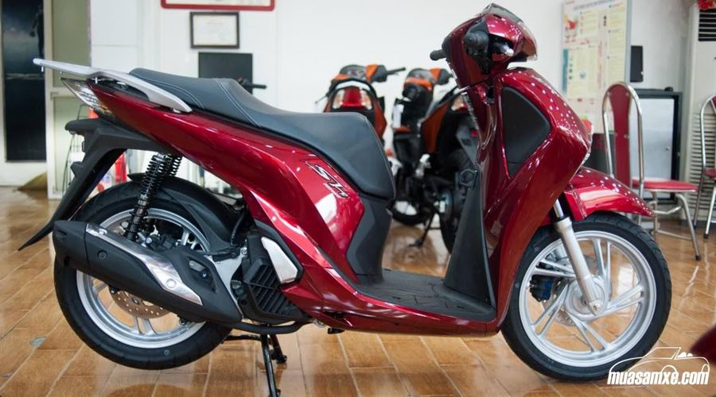</a> <b>SH150 2016 K77 Đỏ R368 phanh ABS (khác dè)</b> <a href="../bo/sh/BO0345.1-sh150-2016-k77-do-r368-phanh-abs-khac-de.md"><code>BO0345.1</code></a></td>
<td align="center" valign="top" width="33%"><a href="../bo/sh/BO0346-sh125-2016-k77-bac-nhb-86-phanh-cbs-khac-de.md">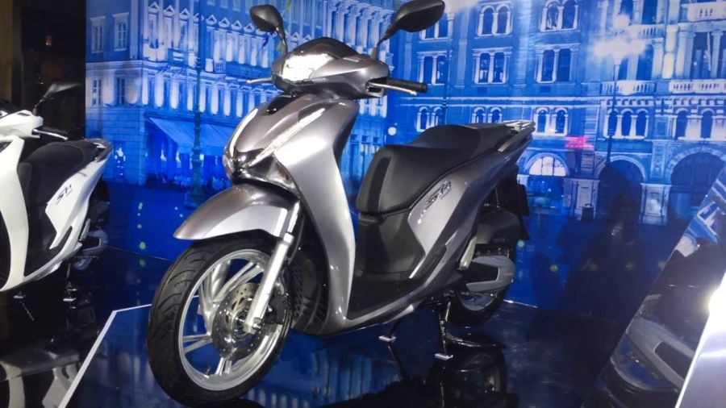</a> <b>SH125 2016 K77 Bạc NHB 86 phanh CBS (khác dè)</b> <a href="../bo/sh/BO0346-sh125-2016-k77-bac-nhb-86-phanh-cbs-khac-de.md"><code>BO0346</code></a></td>
<td align="center" valign="top" width="33%"> <b>SH150 2016 K77 Bạc NHB 86 phanh ABS (khác dè)</b> <a href="../bo/sh/BO0346.1-sh150-2016-k77-bac-nhb-86-phanh-abs-khac-de.md"><code>BO0346.1</code></a></td>
</tr>
<tr>
<td align="center" valign="top" width="33%"> <b>SH125 2020 K0R Đen NH25 PHANH CBS (khác dè)</b> <a href="../bo/sh/BO0347-sh125-2020-k0r-den-nh25-phanh-cbs-khac-de.md"><code>BO0347</code></a></td>
<td align="center" valign="top" width="33%"><a href="../bo/sh/BO0347.1-sh150-2020-k0r-den-nh25-phanh-abs-khac-de.md">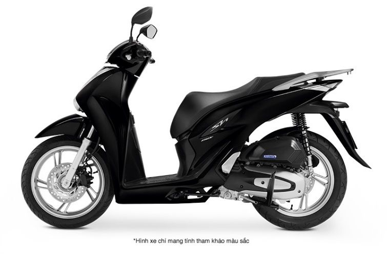</a> <b>SH150 2020 K0R Đen NH25 PHANH ABS (khác dè)</b> <a href="../bo/sh/BO0347.1-sh150-2020-k0r-den-nh25-phanh-abs-khac-de.md"><code>BO0347.1</code></a></td>
<td align="center" valign="top" width="33%"> <b>SH125 2020 K0R Trắng NHB35P phanh CBS (khác dè)</b> <a href="../bo/sh/BO0348-sh125-2020-k0r-trang-nhb35p-phanh-cbs-khac-de.md"><code>BO0348</code></a></td>
</tr>
<tr>
<td align="center" valign="top" width="33%"><a href="../bo/sh/BO0348.1-sh150-2020-k0r-trang-nhb35p-phanh-abs-khac-de.md">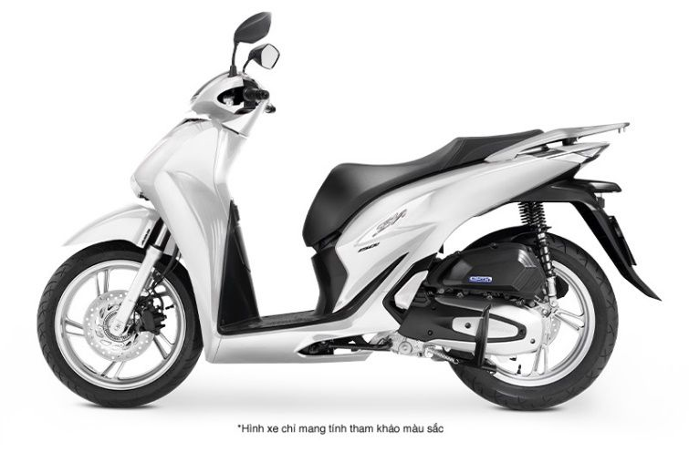</a> <b>SH150 2020 K0R Trắng NHB35P phanh ABS (khác dè)</b> <a href="../bo/sh/BO0348.1-sh150-2020-k0r-trang-nhb35p-phanh-abs-khac-de.md"><code>BO0348.1</code></a></td>
<td align="center" valign="top" width="33%"><a href="../bo/sh/BO0349-sh125-2020-k0r-do-r368c-phanh-cbs-khac-de.md">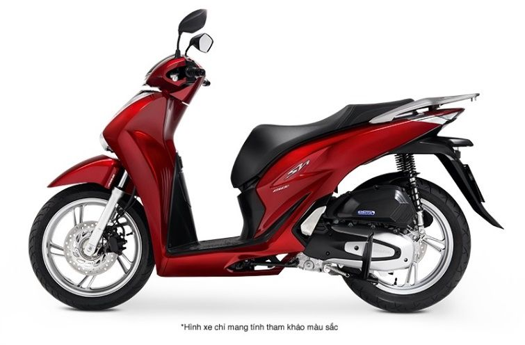</a> <b>SH125 2020 K0R Đỏ R368C phanh CBS (khác dè)</b> <a href="../bo/sh/BO0349-sh125-2020-k0r-do-r368c-phanh-cbs-khac-de.md"><code>BO0349</code></a></td>
<td align="center" valign="top" width="33%"> <b>SH150 2020 K0R Đỏ R368C phanh ABS (khác dè)</b> <a href="../bo/sh/BO0349.1-sh150-2020-k0r-do-r368c-phanh-abs-khac-de.md"><code>BO0349.1</code></a></td>
</tr>
<tr>
<td align="center" valign="top" width="33%"> <b>SH125 2020 K0R Đen Xám NHC26 phanh CBS (khác dè)</b> <a href="../bo/sh/BO0350-sh125-2020-k0r-den-xam-nhc26-phanh-cbs-khac-de.md"><code>BO0350</code></a></td>
<td align="center" valign="top" width="33%"><a href="../bo/sh/BO0350.1-sh150-2020-k0r-den-xam-nhc26-phanh-abs-khac-de.md">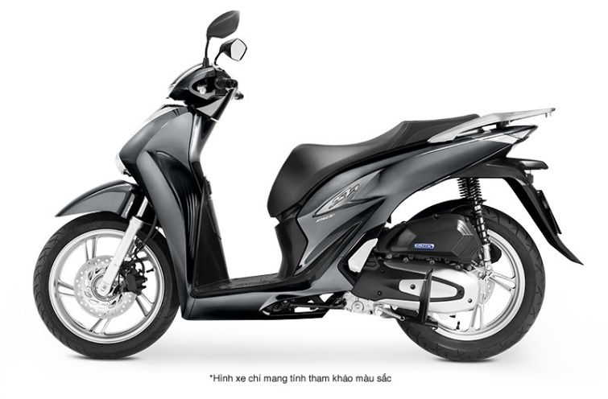</a> <b>SH150 2020 K0R Đen Xám NHC26 phanh ABS (khác dè)</b> <a href="../bo/sh/BO0350.1-sh150-2020-k0r-den-xam-nhc26-phanh-abs-khac-de.md"><code>BO0350.1</code></a></td>
<td align="center" valign="top" width="33%"> <b>SH125 2020 K0R Bạc NHC27 phanh CBS (khác dè)</b> <a href="../bo/sh/BO0351-sh125-2020-k0r-bac-nhc27-phanh-cbs-khac-de.md"><code>BO0351</code></a></td>
</tr>
<tr>
<td align="center" valign="top" width="33%"> <b>SH150 2020 K0R Bạc NHC27 phanh ABS (khác dè0</b> <a href="../bo/sh/BO0351.1-sh150-2020-k0r-bac-nhc27-phanh-abs-khac-de0.md"><code>BO0351.1</code></a></td>
<td align="center" valign="top" width="33%"><a href="../bo/sh/BO0755-sh-150cc-2021-k0r-dac-biet-abs-mau-den-bac-nha76.md">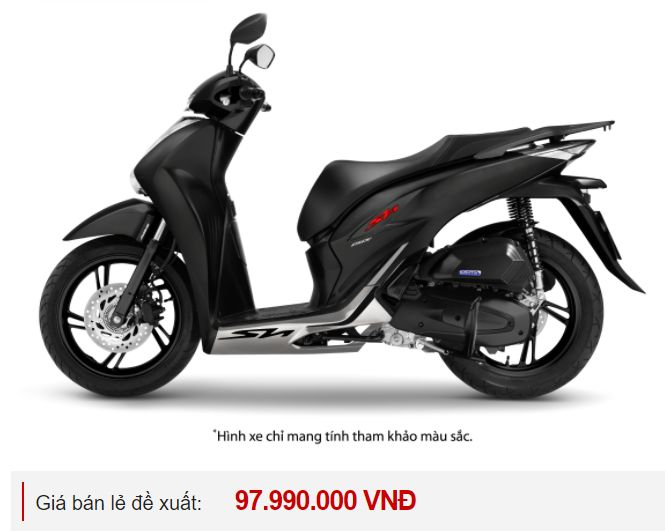</a> <b>SH 150cc 2021 K0R (Đặc Biệt ABS) Màu Đen Bạc \*NHA76\*</b> <a href="../bo/sh/BO0755-sh-150cc-2021-k0r-dac-biet-abs-mau-den-bac-nha76.md"><code>BO0755</code></a></td>
<td align="center" valign="top" width="33%"><a href="../bo/sh/BO0756-sh-150cc-2021-k0r-the-thao-abs-mau-xam-den-nhc60p.md">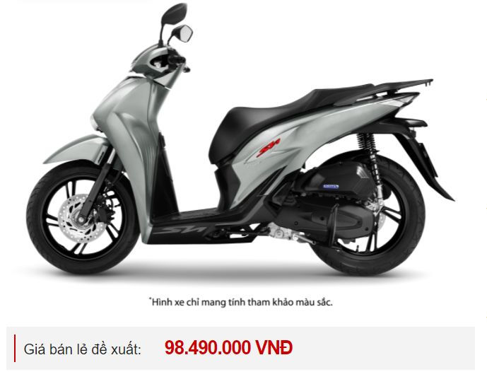</a> <b>SH 150cc 2021 K0R (Thể thao ABS) Màu xám đen \*NHC60P</b> <a href="../bo/sh/BO0756-sh-150cc-2021-k0r-the-thao-abs-mau-xam-den-nhc60p.md"><code>BO0756</code></a></td>
</tr>
<tr>
<td align="center" valign="top" width="33%"><i>Chưa có ảnh</i> <b>SH 125 2020 K0R Màu đỏ \*R350\* phanh CBS</b> <a href="../bo/sh/BO0822-sh-125-2020-k0r-mau-do-r350-phanh-cbs.md"><code>BO0822</code></a></td>
<td align="center" valign="top" width="33%"><i>Chưa có ảnh</i> <b>SH 150 2020 K0R Màu đỏ \*R350\* phanh ABS</b> <a href="../bo/sh/BO0822.1-sh-150-2020-k0r-mau-do-r350-phanh-abs.md"><code>BO0822.1</code></a></td>
<td align="center" valign="top" width="33%"><a href="../bo/sh/BO0843-sh125i-2023-k0r-mau-den-nhb25m-phien-ban-tieu-chuan.md">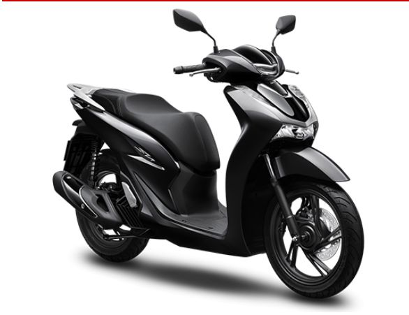</a> <b>SH125i 2023 K0R màu đen \*NHB25M\*, phiên bản tiêu chuẩn</b> <a href="../bo/sh/BO0843-sh125i-2023-k0r-mau-den-nhb25m-phien-ban-tieu-chuan.md"><code>BO0843</code></a></td>
</tr>
<tr>
<td align="center" valign="top" width="33%"><a href="../bo/sh/BO0844-sh125i-2023-k0r-mau-trang-den-nhb35p-phien-ban-tieu-chuan.md">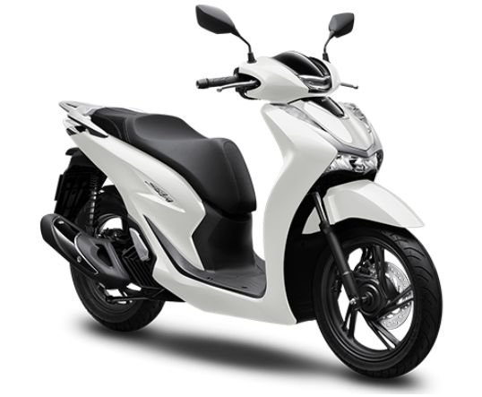</a> <b>SH125i 2023 K0R màu trắng đen \*NHB35P\*, phiên bản tiêu chuẩn</b> <a href="../bo/sh/BO0844-sh125i-2023-k0r-mau-trang-den-nhb35p-phien-ban-tieu-chuan.md"><code>BO0844</code></a></td>
<td align="center" valign="top" width="33%"><a href="../bo/sh/BO0845-sh125i-2023-k0r-mau-do-den-r368c-phien-ban-tieu-chuan.md">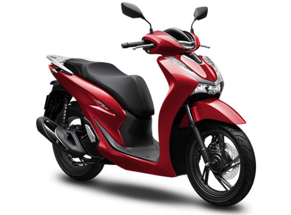</a> <b>SH125i 2023 K0R màu đỏ đen \*R368C\*, phiên bản tiêu chuẩn</b> <a href="../bo/sh/BO0845-sh125i-2023-k0r-mau-do-den-r368c-phien-ban-tieu-chuan.md"><code>BO0845</code></a></td>
<td align="center" valign="top" width="33%"><a href="../bo/sh/BO0846-sh125i-2023-k0r-mau-mo-den-nha76m-phien-ban-dac-biet.md">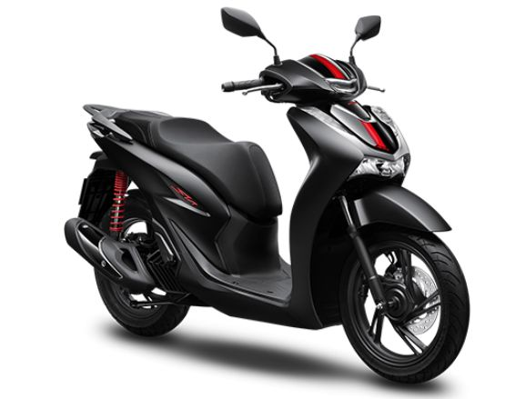</a> <b>SH125i 2023 K0R màu mờ đen \*NHA76M\*, phiên bản đặc biệt</b> <a href="../bo/sh/BO0846-sh125i-2023-k0r-mau-mo-den-nha76m-phien-ban-dac-biet.md"><code>BO0846</code></a></td>
</tr>
<tr>
<td align="center" valign="top" width="33%"><a href="../bo/sh/BO0847-sh125i-2023-k0r-mau-xam-den-nhc60p-phien-ban-the-thao.md">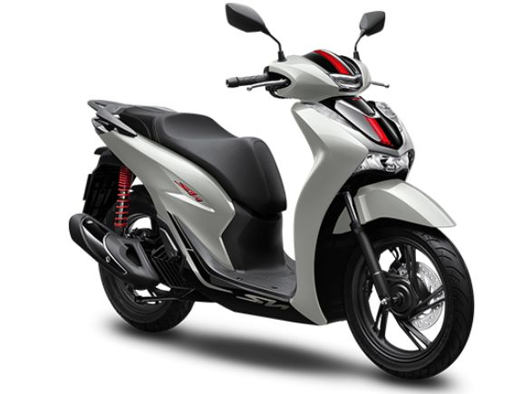</a> <b>SH125i 2023 K0R màu Xám đen \*NHC60P\*, phiên bản thể thao</b> <a href="../bo/sh/BO0847-sh125i-2023-k0r-mau-xam-den-nhc60p-phien-ban-the-thao.md"><code>BO0847</code></a></td>
<td align="center" valign="top" width="33%"><a href="../bo/sh/BO0868-sh125i-2023-k0r-mau-trang-den-phien-ban-cao-cap.md">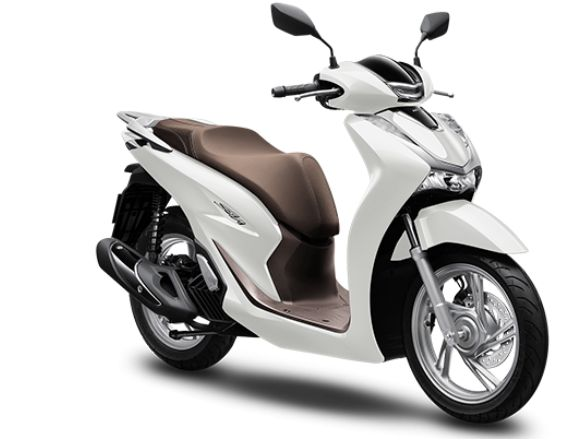</a> <b>SH125i 2023 K0R màu trắng đen, Phiên bản cao cấp</b> <a href="../bo/sh/BO0868-sh125i-2023-k0r-mau-trang-den-phien-ban-cao-cap.md"><code>BO0868</code></a></td>
<td align="center" valign="top" width="33%"><a href="../bo/sh/BO0869-sh125i-2023-k0r-mau-do-den-phien-ban-cao-cap.md">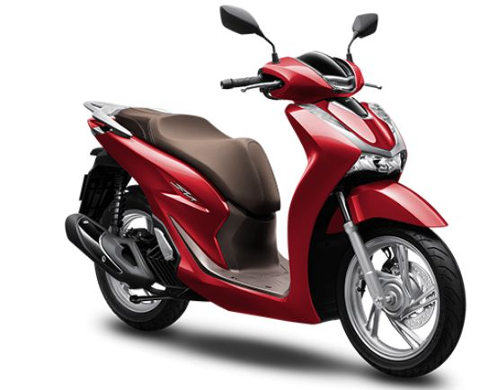</a> <b>SH125i 2023 K0R màu đỏ đen, Phiên bản cao cấp</b> <a href="../bo/sh/BO0869-sh125i-2023-k0r-mau-do-den-phien-ban-cao-cap.md"><code>BO0869</code></a></td>
</tr>
<tr>
<td align="center" valign="top" width="33%"><a href="../bo/sh/BO0870-sh160i-2023-k0r-mau-den-phien-ban-tieu-chuan.md">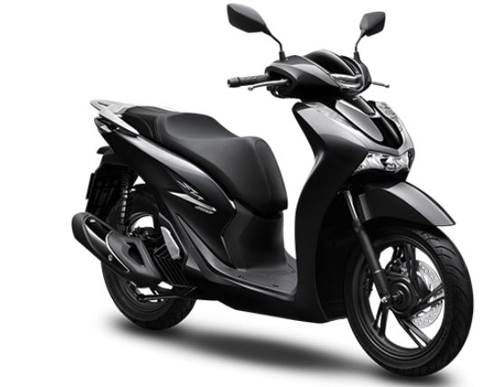</a> <b>SH160i 2023 K0R màu đen, Phiên bản tiêu chuẩn</b> <a href="../bo/sh/BO0870-sh160i-2023-k0r-mau-den-phien-ban-tieu-chuan.md"><code>BO0870</code></a></td>
<td align="center" valign="top" width="33%"><a href="../bo/sh/BO0871-sh160i-2023-k0r-mau-trang-den-phien-ban-tieu-chuan.md">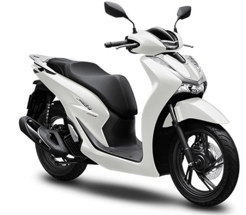</a> <b>SH160i 2023 K0R màu trắng đen , Phiên bản tiêu chuẩn</b> <a href="../bo/sh/BO0871-sh160i-2023-k0r-mau-trang-den-phien-ban-tieu-chuan.md"><code>BO0871</code></a></td>
<td align="center" valign="top" width="33%"><a href="../bo/sh/BO0872-sh160i-2023-k0r-mau-do-den-phien-ban-tieu-chuan.md">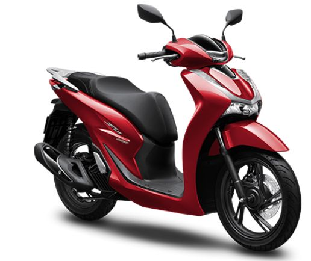</a> <b>SH160i 2023 K0R màu đỏ đen , Phiên bản tiêu chuẩn</b> <a href="../bo/sh/BO0872-sh160i-2023-k0r-mau-do-den-phien-ban-tieu-chuan.md"><code>BO0872</code></a></td>
</tr>
<tr>
<td align="center" valign="top" width="33%"><a href="../bo/sh/BO0873-sh160i-2023-k0r-mau-den-phien-ban-dac-biet.md">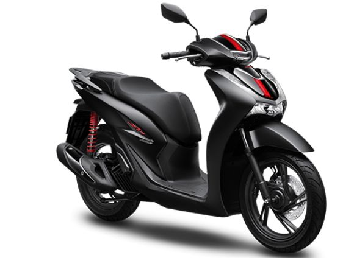</a> <b>SH160i 2023 K0R màu đen , Phiên bản đặc biệt</b> <a href="../bo/sh/BO0873-sh160i-2023-k0r-mau-den-phien-ban-dac-biet.md"><code>BO0873</code></a></td>
<td align="center" valign="top" width="33%"><a href="../bo/sh/BO0874-sh160i-2023-k0r-mau-xam-den-phien-ban-the-thao.md">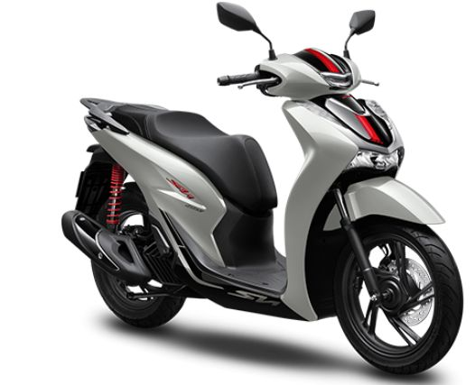</a> <b>SH160i 2023 K0R màu xám đen , Phiên bản thể thao</b> <a href="../bo/sh/BO0874-sh160i-2023-k0r-mau-xam-den-phien-ban-the-thao.md"><code>BO0874</code></a></td>
<td align="center" valign="top" width="33%"><a href="../bo/sh/BO0875-sh160i-2023-k0r-mau-trang-den-phien-ban-cao-cap.md">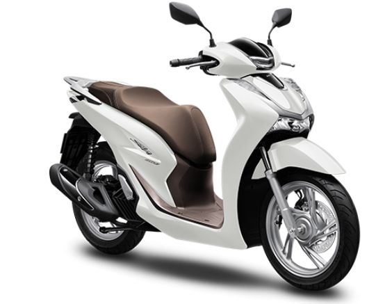</a> <b>SH160i 2023 K0R màu trắng đen , Phiên bản cao cấp</b> <a href="../bo/sh/BO0875-sh160i-2023-k0r-mau-trang-den-phien-ban-cao-cap.md"><code>BO0875</code></a></td>
</tr>
<tr>
<td align="center" valign="top" width="33%"><a href="../bo/sh/BO0876-sh160i-2023-k0r-mau-do-den-phien-ban-cao-cap.md">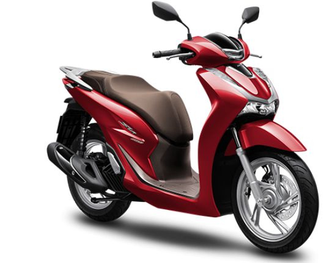</a> <b>SH160i 2023 K0R màu đỏ đen , Phiên bản cao cấp</b> <a href="../bo/sh/BO0876-sh160i-2023-k0r-mau-do-den-phien-ban-cao-cap.md"><code>BO0876</code></a></td>
<td align="center" valign="top" width="33%"><a href="../bo/sh/BO0892-sh125i-2024-k0r-mau-den-phien-ban-tieu-chuan.md">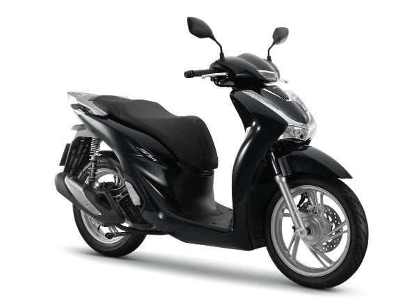</a> <b>SH125i 2024 K0R màu đen, phiên bản Tiêu Chuẩn</b> <a href="../bo/sh/BO0892-sh125i-2024-k0r-mau-den-phien-ban-tieu-chuan.md"><code>BO0892</code></a></td>
<td align="center" valign="top" width="33%"><a href="../bo/sh/BO0893-sh125i-2024-k0r-mau-trang-phien-ban-tieu-chuan.md">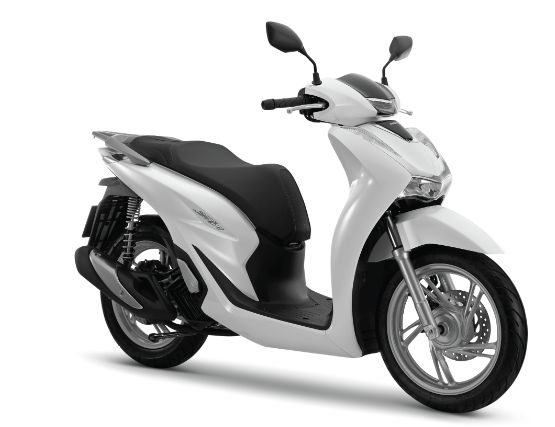</a> <b>SH125i 2024 K0R  màu trắng, phiên bản Tiêu Chuẩn</b> <a href="../bo/sh/BO0893-sh125i-2024-k0r-mau-trang-phien-ban-tieu-chuan.md"><code>BO0893</code></a></td>
</tr>
<tr>
<td align="center" valign="top" width="33%"><a href="../bo/sh/BO0894-sh125i-2024-k0r-mau-do-den-phien-ban-tieu-chuan.md">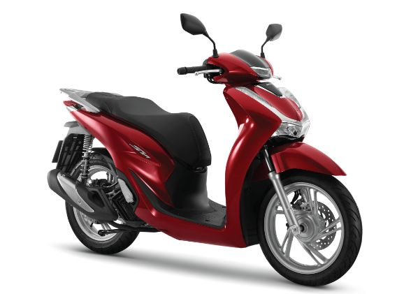</a> <b>SH125i 2024 K0R màu đỏ đen, phiên bản Tiêu Chuẩn</b> <a href="../bo/sh/BO0894-sh125i-2024-k0r-mau-do-den-phien-ban-tieu-chuan.md"><code>BO0894</code></a></td>
<td align="center" valign="top" width="33%"> <b>SH125i 2024 K0R  màu đen, phiên bản đặc biệt</b> <a href="../bo/sh/BO0895-sh125i-2024-k0r-mau-den-phien-ban-dac-biet.md"><code>BO0895</code></a></td>
<td align="center" valign="top" width="33%"> <b>SH125i 2024 K0R màu xám đen, phiên bản thể thao</b> <a href="../bo/sh/BO0896-sh125i-2024-k0r-mau-xam-den-phien-ban-the-thao.md"><code>BO0896</code></a></td>
</tr>
<tr>
<td align="center" valign="top" width="33%"> <b>SH125i 2024 K0R màu trắng đen, phiên bản cao cấp</b> <a href="../bo/sh/BO0897-sh125i-2024-k0r-mau-trang-den-phien-ban-cao-cap.md"><code>BO0897</code></a></td>
<td align="center" valign="top" width="33%"> <b>SH125i 2024 K0R màu đỏ đen, phiên bản cao cấp</b> <a href="../bo/sh/BO0898-sh125i-2024-k0r-mau-do-den-phien-ban-cao-cap.md"><code>BO0898</code></a></td>
<td align="center" valign="top" width="33%"> <b>SH160i 2024 K0R màu đen, phiên bản Tiêu Chuẩn</b> <a href="../bo/sh/BO0899-sh160i-2024-k0r-mau-den-phien-ban-tieu-chuan.md"><code>BO0899</code></a></td>
</tr>
<tr>
<td align="center" valign="top" width="33%"> <b>SH160i 2024 K0R màu trắng đen, phiên bản Tiêu Chuẩn</b> <a href="../bo/sh/BO0900-sh160i-2024-k0r-mau-trang-den-phien-ban-tieu-chuan.md"><code>BO0900</code></a></td>
<td align="center" valign="top" width="33%"> <b>SH160i 2024 K0R màu đỏ đen, phiên bản Tiêu Chuẩn</b> <a href="../bo/sh/BO0901-sh160i-2024-k0r-mau-do-den-phien-ban-tieu-chuan.md"><code>BO0901</code></a></td>
<td align="center" valign="top" width="33%"> <b>SH160i 2024 K0R màu đen, phiên bản đặc biệt</b> <a href="../bo/sh/BO0902-sh160i-2024-k0r-mau-den-phien-ban-dac-biet.md"><code>BO0902</code></a></td>
</tr>
<tr>
<td align="center" valign="top" width="33%"> <b>SH160i 2024 K0R màu xám đen, phiên bản thể thao</b> <a href="../bo/sh/BO0903-sh160i-2024-k0r-mau-xam-den-phien-ban-the-thao.md"><code>BO0903</code></a></td>
<td align="center" valign="top" width="33%"> <b>SH160i 2024 K0R màu trắng đen, phiên bản cao cấp</b> <a href="../bo/sh/BO0904-sh160i-2024-k0r-mau-trang-den-phien-ban-cao-cap.md"><code>BO0904</code></a></td>
<td align="center" valign="top" width="33%"> <b>SH160i 2024 K0R màuđỏ đen, phiên bản cao cấp</b> <a href="../bo/sh/BO0905-sh160i-2024-k0r-maudo-den-phien-ban-cao-cap.md"><code>BO0905</code></a></td>
</tr>
<tr>
<td align="center" valign="top" width="33%"> <b>SH125i 2026 đen NHB25 bản tiêu chuẩn</b> <a href="../bo/sh/BO1009-sh125i-2026-den-nhb25-ban-tieu-chuan.md"><code>BO1009</code></a></td>
<td align="center" valign="top" width="33%"> <b>SH125i 2026 đỏ R368 bản tiêu chuẩn</b> <a href="../bo/sh/BO1010-sh125i-2026-do-r368-ban-tieu-chuan.md"><code>BO1010</code></a></td>
<td align="center" valign="top" width="33%"> <b>SH125i 2026 trắng NHD01 bản tiêu chuẩn</b> <a href="../bo/sh/BO1011-sh125i-2026-trang-nhd01-ban-tieu-chuan.md"><code>BO1011</code></a></td>
</tr>
<tr>
<td align="center" valign="top" width="33%"> <b>SH125i 2026 xám đen NHD03 bản đặc biệt</b> <a href="../bo/sh/BO1012-sh125i-2026-xam-den-nhd03-ban-dac-biet.md"><code>BO1012</code></a></td>
<td align="center" valign="top" width="33%"> <b>SH125i 2026 xám đen đỏ NHC60 bản thể thao</b> <a href="../bo/sh/BO1013-sh125i-2026-xam-den-do-nhc60-ban-the-thao.md"><code>BO1013</code></a></td>
<td align="center" valign="top" width="33%"> <b>SH125i 2026 xanh đen đỏ GY163 bản thể thao</b> <a href="../bo/sh/BO1014-sh125i-2026-xanh-den-do-gy163-ban-the-thao.md"><code>BO1014</code></a></td>
</tr>
<tr>
<td align="center" valign="top" width="33%"> <b>SH125i 2026 trắng đen NHD14 bản cao cấp</b> <a href="../bo/sh/BO1015-sh125i-2026-trang-den-nhd14-ban-cao-cap.md"><code>BO1015</code></a></td>
<td align="center" valign="top" width="33%"> <b>SH160i 2026 đen NHB25 bản tiêu chuẩn</b> <a href="../bo/sh/BO1016-sh160i-2026-den-nhb25-ban-tieu-chuan.md"><code>BO1016</code></a></td>
<td align="center" valign="top" width="33%"> <b>SH160i 2026 trắng NHD01 bản tiêu chuẩn</b> <a href="../bo/sh/BO1017-sh160i-2026-trang-nhd01-ban-tieu-chuan.md"><code>BO1017</code></a></td>
</tr>
<tr>
<td align="center" valign="top" width="33%"> <b>SH160i 2026 xám đen NHD03 bản đặc biệt</b> <a href="../bo/sh/BO1018-sh160i-2026-xam-den-nhd03-ban-dac-biet.md"><code>BO1018</code></a></td>
<td align="center" valign="top" width="33%"> <b>SH160i 2026 xám đen đỏ NHC60 bản thể thao</b> <a href="../bo/sh/BO1019-sh160i-2026-xam-den-do-nhc60-ban-the-thao.md"><code>BO1019</code></a></td>
<td align="center" valign="top" width="33%"> <b>SH160i 2026 xanh đen đỏ GY163 bản thể thao</b> <a href="../bo/sh/BO1020-sh160i-2026-xanh-den-do-gy163-ban-the-thao.md"><code>BO1020</code></a></td>
</tr>
<tr>
<td align="center" valign="top" width="33%"> <b>SH160i 2026 trắng đen NHD14 bản cao cấp</b> <a href="../bo/sh/BO1021-sh160i-2026-trang-den-nhd14-ban-cao-cap.md"><code>BO1021</code></a></td>
<td align="center" valign="top" width="33%"> <b>SH160i 2026 đỏ đen R368 bản cao cấp</b> <a href="../bo/sh/BO1022-sh160i-2026-do-den-r368-ban-cao-cap.md"><code>BO1022</code></a></td>
<td align="center" valign="top" width="33%"> <b>Sh1257150 2018 đen mờ NHA76M</b> <a href="../bo/sh/BO1054-sh1257150-2018-den-mo-nha76m.md"><code>BO1054</code></a></td>
</tr>
</table>
